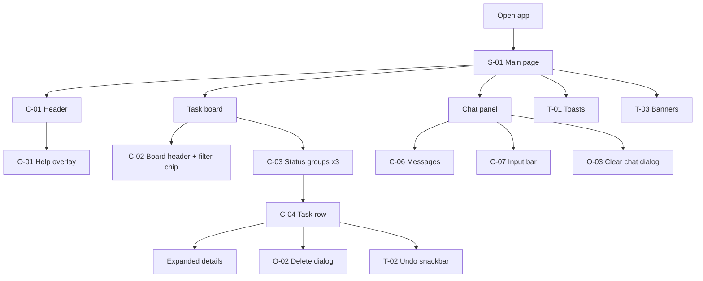
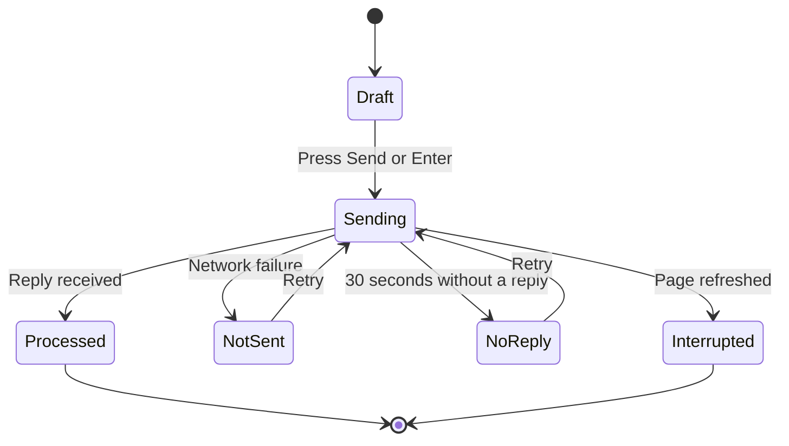
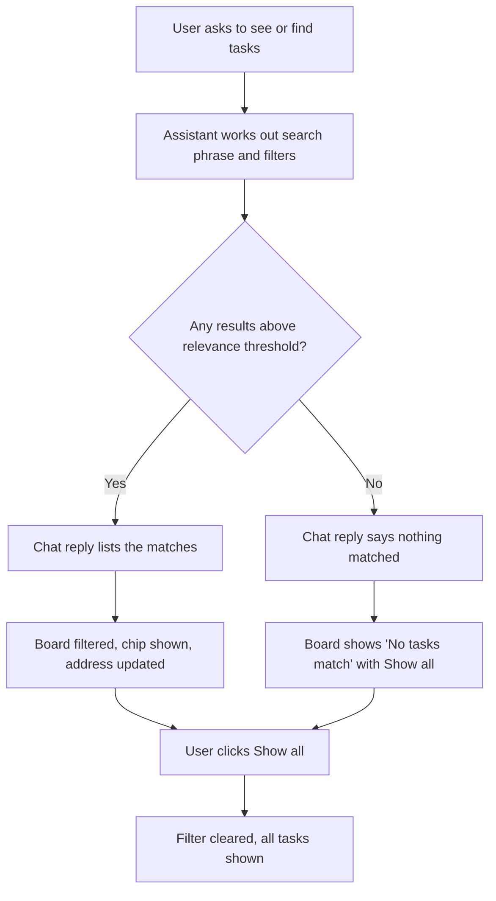
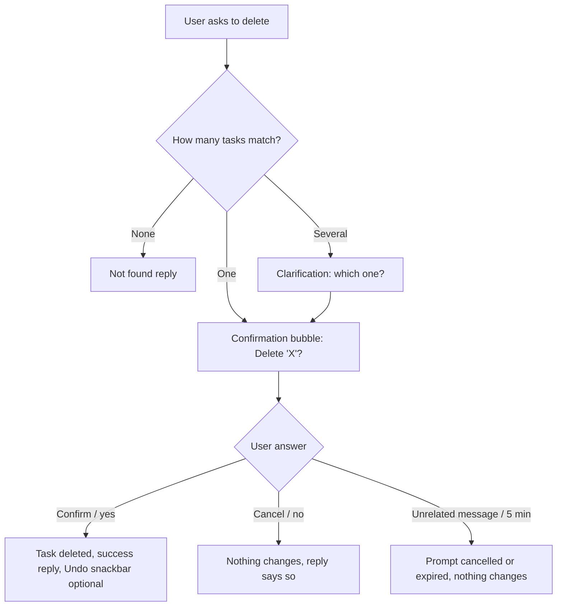

# Screen Flow Document: TaskFlow (AI Agent Task Manager)

| | |
|---|---|
| **Document version** | 1.3, draft for review (v1.1: corner cases. v1.2: "waking up the server" state. v1.3: retry and timeout wording, rate-limit and daily-limit states, aligned with the system design) |
| **Based on** | `task-management-prd.md` v1.3 |
| **Scope** | Screens, navigation, states, user flows, on-screen wording, and data dependencies |
| **Out of scope** | Technology stack, database, architecture, visual styling (colours, fonts) |
| **Audience** | Designers, developers, testers, and the product owner |

---

## 0. How to Read This Document

### 0.1 ID legend

| Prefix | Meaning | Example |
|---|---|---|
| **S-** | Screen (the one page and its main areas) | S-01 Main page |
| **C-** | Component inside a screen | C-04 Task row |
| **O-** | Overlay (dialog or panel above the page) | O-02 Delete dialog |
| **T-** | Transient element (toast, snackbar, banner) | T-02 Undo snackbar |
| **F-** | User flow | F-03 Edit a task |
| **EC-** | Edge-case journey | EC-07 Refresh during a request |
| **M-** | Assistant message template | M-12 Clarification |

### 0.2 Glossary

| Term | Meaning |
|---|---|
| **Board** | The task list on the left (desktop) or top (mobile). |
| **Group** | One of the three status sections on the board: To do, In progress, Done. |
| **Chat panel** | The AI Assistant conversation area, including the input bar. |
| **Instruction** | A message the user types to the assistant. |
| **Filter** | A temporary narrowing of the board (search phrase, status, priority, or due range). |
| **Filter chip** | The visible label showing the active filter, with a "Show all" action. |
| **Clarification** | A question from the assistant when an instruction matches more than one task or is missing information. |
| **Confirmation** | A yes/no question from the assistant before a destructive or bulk action. |
| **Pending prompt** | A clarification or confirmation that is waiting for the user's answer. |
| **Highlight** | A 2-second visual emphasis on a task row that has just changed. |
| **Toast** | A small, self-dismissing message at the edge of the board. |

---

## 1. Product at a Glance

TaskFlow is **one page**. The user types what they want in the chat, the assistant does it, and the board updates immediately. There are no separate pages, menus, or settings.

What the user sees within the first 10 seconds:

1. A **header** with the product name and a help (?) icon.
2. A **task board** showing tasks in three groups: **To do**, then **In progress**, then **Done**.
3. An **AI Assistant** panel with a conversation, a message box, and a **Send** button.

Everything else (dialogs, banners, filter chips) appears on top of this one page when needed and goes away when finished.

---

## 2. Navigation Architecture

### 2.1 Navigation model
- **Single page, single address.** There are no routes, tabs, or menus.
- **Primary navigation:** none. The chat is the primary control.
- **Secondary navigation:** the help (?) icon (opens O-01), status-group headers (collapse/expand), and the filter chip (clear filter).
- **Breadcrumbs:** none, because there is no page hierarchy.
- **Deep linking:** only the active filter is stored in the address (see 2.7).

### 2.2 Screen and component inventory

| ID | Name | Type | Purpose |
|---|---|---|---|
| S-01 | Main page | Screen | Holds the board and chat panel. The only screen. |
| C-01 | Header | Component | Product name, "AI TASK MANAGER" label, help icon. |
| C-02 | Board header | Component | "My tasks" title, helper text, count badge, filter chip. |
| C-03 | Status group | Component | Collapsible section with title, count, and its task rows. |
| C-04 | Task row | Component | One task: circle, title, "due label • status", priority badge, delete icon; expands to show details. |
| C-05 | Chat panel | Component | Conversation area with date separators and messages. |
| C-06 | Message bubble | Component | One user or assistant message (several types, see 4.6). |
| C-07 | Input bar | Component | Message box, character counter, Send button. |
| C-08 | Mobile chat sheet | Component | Mobile-only expandable area above the input bar. |
| O-01 | Help overlay | Overlay | "What can I ask?" with example prompts. |
| O-02 | Delete dialog | Overlay | Confirms deleting one task via the delete icon. |
| O-03 | Clear chat dialog | Overlay | Confirms clearing the chat history. |
| T-01 | Toast | Transient | Short message after a manual action or an error. |
| T-02 | Undo snackbar | Transient | "Task deleted. Undo" for 10 seconds (optional feature). |
| T-03 | Banners | Transient | Offline, data unavailable, back online. |

### 2.3 Site map



### 2.4 Entry points

| Entry | What the user sees |
|---|---|
| Open the app address | Board and chat load (skeletons first), all groups open, no filter. First-time users see the empty state (6.1). |
| Open an address that carries a filter | Same as above, but the board loads already filtered with the filter chip showing (2.7). |
| Return visit | Tasks and full chat history restored; chat scrolled to the latest message; any pending prompt left over from before the refresh shows as "Expired". |
| Click an example prompt (empty state, welcome message, or help overlay) | The prompt text is placed in the input box. It is **not** sent. The input is focused. |
| Click "View updated task board" in an assistant reply | Board scrolls to the changed row, which is highlighted (on mobile the chat sheet also collapses). |

### 2.5 Exit paths

| From | Exit action | Result |
|---|---|---|
| Help overlay (O-01) | Close button, or clicking an example prompt | Overlay closes. Focus returns to the help icon (or to the input box if a prompt was chosen). |
| Delete dialog (O-02) | Cancel or Delete button | Dialog closes. Nothing changes on Cancel. Focus returns to the delete icon (or to the next row after a delete). |
| Clear chat dialog (O-03) | Cancel or Clear chat button | Dialog closes. Nothing changes on Cancel. Focus returns to the Clear chat control. |
| Active filter | Click "Show all" on the filter chip, or ask the assistant to show all tasks | Filter cleared; address cleaned; all tasks show. |
| Pending prompt | Choose a button, type an answer, send an unrelated message, or wait 5 minutes | Resolved, cancelled, or expired (see EC-03). |
| Expanded task row | Click the row again, or expand another row | Row collapses. |
| Mobile chat sheet | Collapse button, drag down, or "View updated task board" | Sheet returns to collapsed. |

### 2.6 Screen transitions

| From | Trigger | To | Notes |
|---|---|---|---|
| S-01 (idle) | Click help icon | O-01 | Focus moves into the overlay. |
| S-01 (idle) | Click delete icon on a row | O-02 | Cancel is focused by default. |
| S-01 (idle) | Click Clear chat | O-03 | Cancel is focused by default. |
| S-01 (idle) | Click a task row | Row expanded | Only one row is expanded at a time. |
| S-01 (idle) | Click a group header | Group collapsed or expanded | State is not saved across refreshes. |
| S-01 (idle) | Send an instruction | S-01 (processing) | Typing indicator shown, Send disabled (F-00). |
| S-01 (processing) | Reply received | S-01 (idle) | Board updated, row highlighted if changed. |
| S-01 (idle) | Click filter chip "Show all" | S-01 (unfiltered) | Address cleaned. |
| S-01 | Delete confirmed | S-01 + T-02 | Undo snackbar for 10 seconds (optional). |
| S-01 | Network lost | S-01 + offline banner | Send disabled, typing allowed. |

### 2.7 Address (URL) and deep linking

The address stores the **active filter** so that it survives a refresh and can be bookmarked or shared.

| Situation | Address |
|---|---|
| No filter | The plain app address, with nothing added. |
| Search phrase and status | `/?q=documentation&status=open` |
| Priority only | `/?priority=high` |
| Combination | `/?q=report&status=todo&priority=high&due=this-week` |

**Parameters**

| Parameter | Meaning | Allowed values |
|---|---|---|
| `q` | Natural-language search phrase | Any text |
| `status` | Status filter | `todo`, `in-progress`, `done`, `open` (open = To do + In progress, shown as "Unfinished") |
| `priority` | Priority filter | `low`, `medium`, `high` |
| `due` | Due-date filter | `overdue`, `today`, `this-week`, `none` (no due date) |

**Rules**
1. Whenever a filter is applied (by a chat instruction), the address is updated to match. When it is cleared, the parameters are removed.
2. On page load, the filter is read from the address, the chip is shown, and the search runs again so results are current.
3. Unknown parameters or values are ignored silently, and the address is cleaned.
4. Changing the filter **replaces** the current address entry rather than adding a new one, so the Back button does not step through filters.
5. The address contains only the filter, never task data or chat content. There is no login, so anyone opening the same address with access to the app sees the same task list with that filter applied.
6. If the saved filter cannot be applied on load, see state ER-05 in 6.3.
7. Selected (expanded) rows, collapsed groups, and open overlays are **not** stored in the address.

### 2.8 Browser Back button
- The app does **not** add history entries of its own.
- **Mobile:** if an overlay or dialog is open, Back closes it first. Otherwise Back behaves as the browser normally does.
- **Desktop:** normal browser behaviour.

### 2.9 Keyboard behaviour
Only these input shortcuts are defined:

| Key | Action |
|---|---|
| **Enter** (in the message box) | Send the message |
| **Shift + Enter** (in the message box) | Insert a new line |

All other interactions use standard keyboard navigation: Tab and Shift+Tab move between controls, Enter or Space activates a focused control, and focus always has a visible outline. Dialogs are closed with their visible **Cancel** or **Close** buttons.

---

## 3. Layout and Wireframes

Wireframes show structure and content only, not colours or exact sizes.

### 3.1 Desktop (wide screens, side by side)

```
+--------------------------------------------------------------------------------+
| TASKFLOW                                         AI TASK MANAGER           (?)  |
+--------------------------------------------------------------------------------+
| My tasks                                   |  * AI Assistant                    |
| Organize tasks by asking your AI assistant |  Manage everything with a message  |
|                                            |  [Clear chat]                      |
| +----------------------------------------+ |  --------------------------------- |
| | Task board         [All tasks  6]      | |  Today                             |
| | (filter chip appears here when active) | |                                    |
| |                                        | |        +----------------------+    |
| | v To do (3)                            | |        | Move my presentation |    |
| | ( ) Finish AI presentation   [High]  X | |        | task to In progress. |    |
| |     Tomorrow . To do                   | |        +----------------------+    |
| | ( ) Send weekly report       [High]  X | |  +--------------------------+      |
| |     Friday . To do                     | |  | Done. I moved 'Finish AI |      |
| | ( ) Update API documentation  [Low]  X | |  | presentation' to In      |      |
| |     Next week . To do                  | |  | progress.                |      |
| |                                        | |  | View updated task board  |      |
| | v In progress (1)                      | |  +--------------------------+      |
| | ( ) Review pull request #82 [Medium] X | |                                    |
| |     Today . In progress                | |  +------------------------------+  |
| |                                        | |  | YOUR INSTRUCTION             |  |
| | v Done (2)                             | |  | Type a task instruction...   |  |
| | (v) Set up database         [Medium] X | |  | e.g. Complete weekly report  |  |
| |     Completed . Done                   | |  |                    [ Send ]  |  |
| | (v) Write project README      [Low]  X | |  +------------------------------+  |
| |     Completed . Done                   | |                                    |
| +----------------------------------------+ |                                    |
+--------------------------------------------------------------------------------+
   ( ) = open completion circle   (v) = completed   X = delete icon   v = group open
```

**Order of groups is fixed: To do, then In progress, then Done.**

### 3.2 Mobile (stacked, input pinned)

```
+--------------------------------+
| TASKFLOW   AI TASK MANAGER  (?)|
+--------------------------------+
| My tasks                       |
| [All tasks 6]                  |
|                                |
| v To do (3)                    |
| ( ) Finish AI presentation     |
|     Tomorrow . To do   [High]  |
| ( ) Send weekly report         |
|     Friday . To do     [High]  |
| ...                            |
| v In progress (1)              |
| v Done (2)                     |
|                                |
|     (board scrolls)            |
+--------------------------------+
| AI Assistant         [expand ^]|  <- C-08 chat sheet (collapsed)
| Done. I moved 'Finish AI...    |
| View updated task board        |
+--------------------------------+
| Type a task instruction...     |  <- C-07 input bar (always visible,
|                      [ Send ]  |     pinned to the bottom)
+--------------------------------+
```

### 3.3 Mobile, chat sheet expanded

```
+--------------------------------+
| AI Assistant  [Clear chat] [v] |  <- collapse
+--------------------------------+
| Today                          |
|        Move my presentation... |
| Done. I moved 'Finish AI...'   |
|        Find tasks related to   |
|        documentation.          |
| Found 1 task: Update API...    |
| ...                            |
+--------------------------------+
| Type a task instruction...     |
|                      [ Send ]  |
+--------------------------------+
```

### 3.4 Responsive rules

| Rule | Detail |
|---|---|
| Side-by-side layout | Used when the window is wide enough for both panels comfortably (about 900 px and wider). Otherwise stacked. |
| Chat input visibility | Always visible on every screen size. Never hidden behind the board or a tab. |
| No sideways scrolling | At any width. Long titles are cut at 2 lines; badges never overflow the row. |
| Touch targets | Circle, delete icon, buttons, and chips are large enough for a finger. |
| On-screen keyboard (mobile) | The input bar stays visible above the keyboard; the sheet shrinks as needed. |

---

## 4. Screen and Component Specifications

### 4.1 C-01 Header
- Shows "TASKFLOW" and the label "AI TASK MANAGER".
- Help icon (?) at the right opens **O-01**.
- No menu, no settings, no profile.

### 4.2 C-02 Board header

| Element | Behaviour |
|---|---|
| Title "My tasks" and helper text "Organize tasks by asking your AI assistant" | Always shown. |
| **Count badge** | Unfiltered: "All tasks 6". Filtered: "3 of 6 tasks". |
| **Filter chip** | Appears only when a filter is active. Text example: "Filtered: documentation • Unfinished" with a "Show all" action. |

**Filter chip wording**
- Search phrase appears as typed (shortened if long).
- Status labels: Unfinished (open), To do, In progress, Done.
- Priority labels: High priority, Medium priority, Low priority.
- Due labels: Overdue, Due today, Due this week, No due date.
- Parts are separated by " • ".

### 4.3 C-03 Status group

| Aspect | Rule |
|---|---|
| Order | Always **To do**, then **In progress**, then **Done**. |
| Header | Chevron, group name, task count in brackets (for example "To do (3)"). Click toggles collapse. |
| Default | All three groups are open on every page load. Collapse state is not saved. |
| Empty group (unfiltered) | Header stays, count (0), and a muted line "Nothing here yet". |
| Empty group (filtered) | Header stays, count (0), and a muted line "No matches". |
| All tasks Done | The To do group shows "You're all caught up". |
| Sorting inside a group | See 7.5. |

### 4.4 C-04 Task row

**Collapsed row (matches the reference image)**

| Position | Content |
|---|---|
| Left | Completion circle (empty for To do and In progress, check mark for Done). |
| Main line | Task title (maximum 2 lines, then "…"). |
| Second line | "Due label • Status" (for example "Tomorrow • To do"). Done tasks read "Completed • Done". |
| Right | Priority badge (High, Medium, Low) and the delete icon. |
| Done rows | Muted (greyed) title and text. |
| Overdue open rows | Second line starts with a warning-coloured "Overdue • 2 days" (7.5). |

**Expanded row (click the row, not the circle or icon)**

| Field | Shown as |
|---|---|
| Full title | Complete text, no cut-off. |
| Description | Full text, or muted "No description" if empty. |
| Due date | Full date with year (for example "Wed 28 Oct 2026"), or muted "No due date". |
| Status and priority | Text labels. |
| Completed on | Done tasks only (for example "Completed 27 Oct 2026"). |

Rules: only **one** row is expanded at a time. Expanding another row collapses the first. There are no edit fields in the expanded view, because editing happens through chat.

**Row controls**

| Control | Behaviour |
|---|---|
| Completion circle (open task) | Marks the task Done immediately. If the save fails, the circle reverts and a toast explains (ER-07). |
| Completion circle (Done task) | Reopens the task as **To do**. The row moves to the To do group. |
| Delete icon | Opens **O-02**. The task is not deleted until confirmed. |

**Row highlight:** a row changed by the assistant, or moved between groups, is highlighted for 2 seconds. For users who prefer reduced motion, the highlight is a static outline instead of an animation.

### 4.5 C-05 Chat panel

| Element | Behaviour |
|---|---|
| Header | "AI Assistant", helper line "Manage everything with a message", and a **Clear chat** control. |
| Conversation area | Scrolls. Newest message at the bottom. Date separators appear between days ("Today", "Yesterday", then dates with year such as "26 Oct 2026"). |
| Auto-scroll | New messages scroll into view unless the user has scrolled up. If so, a "New message ↓" pill appears; clicking it scrolls to the bottom. |
| History size | The latest 50 messages load first. A "Load earlier messages" link at the top loads 50 more each time. |
| Welcome message | Shown when the history is empty (see 6.1). |
| Timestamps | Shown with each message (time of day in the user's time zone). |

### 4.6 C-06 Message types

| Type | Who | Appearance | Contains |
|---|---|---|---|
| User message | User | Right-aligned bubble | The typed text. Status marker if not yet processed (see below). |
| Success reply | Assistant | Left bubble | What was done, the task name, the new values, and "View updated task board" when something changed. |
| List / search reply | Assistant | Left bubble | A short sentence and a list of matching tasks (title, status, due label), plus "View on board". |
| Clarification | Assistant | Left bubble with numbered buttons | The question and numbered candidates (title, status, due label). |
| Confirmation | Assistant | Left bubble with Confirm and Cancel buttons | What will happen and to which task(s). |
| Error reply | Assistant | Left bubble, error styling | What went wrong, in plain language, and what to do. Retry when relevant. |
| Decline reply | Assistant | Left bubble | A polite refusal and a short list of what the assistant can do. |
| Expired prompt | Assistant | Greyed bubble | The original question with the label "Expired"; buttons disabled. |

**User message status markers**

| Marker | When shown |
|---|---|
| (none) | Processed normally. |
| "Sending…" | Message sent, no reply yet. |
| "Not sent" + **Retry** | The message could not be delivered (ER-01). |
| "No reply" + **Retry** | No reply within 30 seconds (ER-02). |
| "This may not have completed. Check your board or send it again." | The page was refreshed while the request was running (EC-07). |

### 4.7 C-07 Input bar

| Element | Behaviour |
|---|---|
| Label | "YOUR INSTRUCTION" |
| Message box | Placeholder "Type a task instruction…" and the hint "e.g. Complete the weekly report". Grows up to about 4 lines, then scrolls. |
| Send button | Enabled only when the box has text and the app is ready. |
| Character counter | Appears from 800 characters, shown as "812 / 1000". Turns to a warning at 1000. Over the limit: Send is disabled and the counter reads "Too long by N characters". Text is never cut off. |
| Draft saving | Unsent text is saved and restored after a refresh. |

**Input bar states**

| State | Message box | Send | Notes |
|---|---|---|---|
| Ready | Editable | Enabled if text | Normal. |
| Processing | Editable | Disabled; Enter ignored | Typing indicator in chat. |
| Offline | Editable | Disabled | Banner T-03 explains. |
| Tasks unavailable | Disabled | Disabled | Placeholder: "Your tasks aren't available right now." Banner T-03 explains. |
| Over length | Editable | Disabled | Counter shows how much to remove. |

### 4.8 C-08 Mobile chat sheet

| State | What it shows |
|---|---|
| Collapsed (default) | A strip above the input bar showing the latest assistant message (2 lines) and an "expand" control. |
| Peek | Opens automatically at about half height when a pending prompt needs buttons (clarification or confirmation). |
| Expanded | Full-height conversation with the Clear chat control and a "collapse" control. |

A new assistant reply updates the collapsed strip and briefly pulses it. The input bar stays pinned in every state.

### 4.9 O-01 Help overlay ("What can I ask?")

Opened from the help icon. Static content, so it never needs to load.

| Section | Example prompts (clickable) |
|---|---|
| Create | "Create a high-priority task to finish the demo tomorrow" |
| Find | "Show all unfinished tasks related to documentation" |
| Change | "Change the priority of the API task to Low" |
| Move and complete | "Move the demo task to In progress and mark the weekly report Done" |
| Delete | "Delete the README task" |
| Bulk | "Mark all documentation tasks Done" |

Also shows 3 short tips: tasks can be described in your own words; the assistant asks when it is unsure; deleting always asks first. Clicking a prompt fills the input box (not sent) and closes the overlay. A **Close** button is always visible.

### 4.10 O-02 Delete dialog (manual delete icon)

```
+-------------------------------------+
| Delete 'Update API documentation'?  |
| This task will be removed.          |
|                                     |
|            [ Cancel ]   [ Delete ]  |
+-------------------------------------+
```
Cancel is focused by default. After Delete, the task disappears and the optional undo snackbar T-02 appears.

### 4.11 O-03 Clear chat dialog

```
+-------------------------------------+
| Clear the chat?                     |
| Your tasks won't be affected.       |
|                                     |
|       [ Cancel ]   [ Clear chat ]   |
+-------------------------------------+
```
After clearing, the chat shows the welcome message again (6.1). Pending prompts are discarded.

### 4.12 Transient elements

| ID | Element | Placement | Duration | Content |
|---|---|---|---|---|
| T-01 | Toast (success/info) | Bottom of the board area | 5 seconds, can be dismissed | Result of a manual action ("Marked Done"). |
| T-01 | Toast (error) | Same | 8 seconds, can be dismissed | "Couldn't save that change. Please try again." |
| T-02 | Undo snackbar (optional) | Bottom of the board area | 10 seconds | "'Task name' deleted. **Undo**" |
| T-03 | Offline banner | Full width, top of page | While offline | "You're offline. You can type, but Send is turned off until you're back online." |
| T-03 | Back online banner | Full width, top of page | 3 seconds | "You're back online." |
| T-03 | Data unavailable banner | Full width, top of page | Until resolved | "We can't reach your tasks right now. **Retry**" |

---

## 5. Core User Flows

### F-00 Sending any instruction (shared steps)



| Step | User | System |
|---|---|---|
| 1 | Types text. | Counter appears from 800 characters. Draft is saved. |
| 2 | Presses Send or Enter. | Message appears in chat with "Sending…". Box clears. Send disabled. |
| 3 | Waits. | Typing indicator appears. After 5 seconds it reads "Still working…". |
| 4 | Reads the reply. | Reply shown. Board refreshed. Changed rows highlighted. Send enabled. |
| 5a | (Failure) | See ER-01 to ER-03. |

### F-01 Create a task

| Step | Detail |
|---|---|
| Trigger | "Create a high-priority task to finish the demo tomorrow" |
| Success | Task appears in **To do** with priority High and tomorrow's date. Reply: "Done. I created 'Finish the demo' as High priority, To do, due Wed 28 Oct 2026. View updated task board". |
| No priority given | Created as **Low**. The reply states "Low priority". |
| No title | Assistant asks "What should the task be called?" Nothing is created. |
| Similar task exists | Assistant asks "You already have 'Finish the demo'. Create another anyway?" with **Create anyway** and **Cancel**. |
| Unclear date | Assistant asks "I wasn't sure which date you meant. Which day do you want?" |
| Several tasks in one message | Each is created; the reply lists all of them. A repeated title in the same message is flagged as a possible duplicate before it is created. |
| **Past due date** | "Create a task to file taxes due 20 Oct 2026" → created in To do. Reply: "Done. I created 'File taxes' as Low priority, To do, due Tue 20 Oct 2026. That date is in the past, so the task shows as overdue." The row reads "Overdue • 7 days". |
| Weekday name | "due Friday" always means the **next upcoming** Friday, never a past one. |
| Date without a year | "due 12 Nov" → "due Thu 12 Nov 2026". If that date has already passed this year, the next year is used and the reply says so ("due Tue 12 Jan 2027"). |
| Ambiguous numeric date | "due 03/04/2026" → "Do you mean 3 April 2026 or 4 March 2026?" with one button for each. Nothing is created until answered. |
| Date that doesn't exist | "due 30 Feb" → "30 Feb isn't a real date. Which day did you mean?" |
| Date more than a year ahead | "Did you mean 12 Nov 2028?" with **Yes** and **No** buttons. |
| Title or description too long | Title over 200 or description over 1,000 characters → the assistant asks the user to shorten it. Nothing is created. |

### F-02 List and search



| Step | Detail |
|---|---|
| Trigger | "Show all unfinished tasks related to documentation" |
| System | Finds tasks by meaning, keeps only To do and In progress, drops weak matches. |
| Chat reply | "I found 2 unfinished tasks about documentation:" followed by the list, then "View on board". |
| Board | Filtered to those tasks, still in group order. Count reads "2 of 6 tasks". Chip: "Filtered: documentation • Unfinished". |
| Zero results | Chat: "I couldn't find any tasks about 'x'." Board: "No tasks match 'x'" with a **Show all** button. |
| Clearing | "Show all" on the chip, or "Show all my tasks" in chat. |

### F-03 Edit a task

| Step | Detail |
|---|---|
| Trigger | "Change the priority of the API task to Low" |
| One match | Change applied. Reply: "Done. 'Update API documentation' is now Low priority." Row highlighted. |
| Several matches | Clarification (F-10). Nothing changes until answered. |
| No match | "I couldn't find a task matching 'API'." plus the closest matches, if any. |
| Other edits | Title, description, due date. "Remove the due date from the demo task" clears it. |
| Invalid value | Explains the valid values (see F-17). |

### F-04 Change status ("move")

| Step | Detail |
|---|---|
| Trigger | "Move my presentation task to In progress" |
| Success | Row animates from To do to In progress, scrolls into view, highlighted 2 seconds. Reply: "Done. I moved 'Finish AI presentation' to In progress." |
| Already in that status | "'Finish AI presentation' is already In progress. No change needed." |
| Hidden by filter | Reply adds "This task isn't in your current filter." with **Show all**. |
| **Reverse a completion** | "Move the database task back to In progress" (task is Done) → row leaves **Done**, enters **In progress**, is no longer muted, and its completed date is removed. Reply: "Done. I moved 'Set up database' back to In progress." |
| **Skip or step back** | Any status can go to any other: To do → Done, Done → To do, In progress → To do. No step is blocked. |
| Reversed task is overdue | If the due date has passed, the reopened task shows "Overdue • N days". |
| Asked twice | Sending the same instruction again replies "already in that status. No change needed." |

### F-05 Complete or reopen

| Step | Detail |
|---|---|
| Complete (chat) | "Mark the weekly report Done" → row moves to **Done** (muted), count updates. |
| Complete (manual) | Click the circle. Row moves instantly; a toast "Marked Done" appears. |
| Reopen (chat) | "Reopen the database task" → moves to **To do**. "Move the database task back to In progress" → moves to **In progress**. The completed date is cleared. Reply: "Done. I reopened 'Set up database' as To do." |
| Completing an overdue task | The "Overdue" label disappears and the row shows "Completed • Done". |
| Reopen (manual) | Click the check mark. Task returns to **To do**. |

### F-06 Multi-action message

| Step | Detail |
|---|---|
| Trigger | "Move the demo task to In progress and mark the weekly report Done" |
| Handling | Each action is handled independently, in the order written. |
| Reply | One message with a line per action: ✓ done, ✗ failed (with reason), or ⏸ waiting for you (clarification or confirmation). |
| Partial failure | Valid actions are applied. Failed ones are explained. Nothing is rolled back. |
| Ambiguous or destructive part | That action waits. Others are applied right away. |

### F-07 Delete via chat



Even with a single clear match, **deletion always asks first**.

### F-08 Delete via the delete icon

Click the icon → O-02 → **Delete** → row removed, undo snackbar (optional). **Cancel** → nothing changes.

### F-09 Bulk action

| Step | Detail |
|---|---|
| Trigger | "Mark all documentation tasks Done" or "Delete all completed tasks" |
| Preview | Confirmation bubble: "This will mark 3 tasks as Done:" and the list (first 10, then "+ N more"), then **Confirm** and **Cancel**. |
| Confirm | All listed tasks change. Reply: "Done. I marked 3 tasks as Done." |
| Cancel | Nothing changes. Reply: "Okay, I didn't change anything." |
| Zero matches | "No tasks match that, so nothing was changed." |

### F-10 Clarification (several tasks match)

```
Assistant: I found 2 tasks that could be 'the API task'. Which one do you mean?
           1. Update API documentation   (To do • Next week)
           2. Review API pull request    (In progress • Today)
           [ 1 ]  [ 2 ]  [ Cancel ]
```

| Step | Detail |
|---|---|
| Answer | Click a number button, or type "2", or type the task name. |
| After the answer | The original instruction is carried out and the reply confirms it. |
| Cancel | Pending prompt closes; nothing changes. |
| No answer | Expires after 5 minutes (greyed out "Expired"). |
| Multiple prompts at once | Asked **one at a time**, in the order written. Only the active prompt has working buttons; the others wait their turn. |

### F-11 Load sample tasks

| Step | Detail |
|---|---|
| Where | Empty-state button on the board. |
| While loading | Button shows a spinner and is disabled. |
| Result | The six reference tasks appear in their correct groups. Chat shows "I added 6 sample tasks." |
| Used twice or after deleting some | Only the missing sample tasks are added (matched by title). If all are present: "The sample tasks are already there." If some were missing: "I added 2 of the sample tasks that were missing." |
| Sample due dates | Set relative to the day they are loaded, as in the reference (Tomorrow, Today, Friday, Next week). The two completed samples have no due date. |
| While a request is running | The button is disabled. |

### F-12 Clear chat

Click **Clear chat** → O-03 → **Clear chat** → conversation replaced by the welcome message. Tasks and the filter are unchanged. Pending prompts are discarded.

### F-13 Help

Click (?) → O-01 → click an example (fills the input, not sent) or Close.

### F-14 Off-topic request

User: "What's the capital of France?"  
Assistant: "I'm built to manage your tasks, so I can't help with that. I can create, find, edit, move, complete and delete tasks. For example: 'Create a task to call the bank on Friday'."

### F-19 Messages the assistant can't act on

| Situation | Behaviour |
|---|---|
| Not understood or gibberish | Message M-32, with examples. Nothing changes. |
| Greeting ("hi") | Message M-33, with example chips. |
| "What can you do?" or "help" | Message M-34, with example chips. |
| Question about tasks ("How many tasks are overdue?") | Message M-35: the number, with a **Show them** button that filters the board. |
| Unsupported feature (reorder, reminders, recurring, copy, assign, attachments) | Message M-36. |
| Not in English | Message M-37. |
| "Delete it" with nothing discussed yet | Message M-38: asks which task and shows the 5 most recently changed tasks as numbered buttons. |
| "Delete everything" or "delete all tasks" | Bulk delete: message M-44 with the total count and a **Delete all N tasks** button. |
| Wording that tries to skip confirmation ("delete all, don't ask") | Ignored. The confirmation is still shown. |
| A title that sounds like a command ("Create a task: delete old files") | Treated as a title. Nothing is deleted. |

### F-15 Undo a delete (optional)

After a delete, the snackbar T-02 shows for 10 seconds. **Undo** restores the task (or all tasks from that bulk delete) with all its details, and it returns to its original group. After 10 seconds the delete is final.

### F-16 Reply to a pending prompt by typing

| Typed text | Meaning |
|---|---|
| "1", "2", … or a candidate's name | Choose that candidate. |
| "yes", "confirm", "ok" | Confirm. |
| "no", "cancel" | Cancel. |
| Anything else | Treated as a new instruction; the pending prompt is cancelled with a note (EC-03). |

### F-17 Invalid input

| Input | Reply |
|---|---|
| Unknown status | "I can set a task to To do, In progress or Done. Which one do you want?" |
| Unknown priority | "Priority can be Low, Medium or High. Which one do you want?" |
| Close wording (for example "urgent", "started") | Mapped to the nearest valid value, and the reply says so ("I treated 'urgent' as High priority."). |
| Empty title | "A task needs a title. What should I call it?" |
| Rename to an empty title | "A task needs a title, so I kept the old name 'Finish the demo'." |
| Unreadable date | "I couldn't understand that date. Try 'tomorrow', 'Friday' or '12 Nov 2026'." |

### F-18 Search is repeated or changed

A new search replaces the previous filter. Chat shows both searches in the history; the board and chip always show only the latest.

---

## 6. State Specifications

### 6.1 Empty states

| ID | Situation | Board | Chat | Input |
|---|---|---|---|---|
| EM-01 | **First launch, no tasks** | Message "No tasks yet", hint "Ask the assistant to create your first task", a **Load sample tasks** button, and 3 example prompt chips. All three group headers visible with count 0. | Welcome message (below) with 3–4 example chips. | Ready. |
| EM-02 | **Chat cleared or no history** | Unchanged. | Welcome message. | Ready. |
| EM-03 | **Search with zero results** | "No tasks match 'x'" with **Show all**. Group headers hidden. Count "0 of 6 tasks". | Assistant states nothing matched. | Ready. |
| EM-04 | **Group empty** | "Nothing here yet" (unfiltered) or "No matches" (filtered). | Unchanged. | Ready. |
| EM-05 | **All tasks Done** | To do group: "You're all caught up". | Unchanged. | Ready. |
| EM-06 | **No description** | Expanded row shows "No description". | n/a | n/a |
| EM-07 | **No due date** | Second line shows no date label, only the status. Expanded view: "No due date". | n/a | n/a |

**Welcome message (M-01):**  
"Hi! I can create, find, edit, move, complete and delete your tasks. Just tell me what you need. Try one of these:" followed by chips such as "Create a high-priority task to finish the demo tomorrow", "Show all unfinished tasks", "Mark the weekly report Done".

```
First launch (desktop board area)
+----------------------------------------+
| Task board              [All tasks  0] |
|                                        |
|            (task icon)                 |
|           No tasks yet                 |
|  Ask the assistant to create your      |
|  first task.                           |
|                                        |
|      [ Load sample tasks ]             |
|                                        |
|  (Create a task...) (Show all tasks)   |
|                                        |
| v To do (0)          Nothing here yet  |
| v In progress (0)    Nothing here yet  |
| v Done (0)           Nothing here yet  |
+----------------------------------------+
```

```
Search with zero results
+----------------------------------------+
| Task board           [0 of 6 tasks]    |
| Filtered: invoices   [ Show all ]      |
|                                        |
|        No tasks match 'invoices'       |
|        [ Show all ]                    |
+----------------------------------------+
```

### 6.2 Loading states

| ID | Situation | What the user sees | Limits |
|---|---|---|---|
| LD-01 | **First page load** | Board: skeleton group headers and 4 skeleton rows. Chat: 3 skeleton bubbles. Input visible but disabled until the board is ready. No full-page spinner. | After 3 seconds with no response: LD-08 (waking up). After 90 seconds: error state ER-04. |
| LD-02 | **Filter applied from the address** | Board skeleton, then filtered results with the chip. | Same limits as LD-01. |
| LD-03 | **Assistant working** | Typing indicator bubble. Send disabled; box stays editable. | After 5 seconds: "Still working…". After 30 seconds: ER-02. No Cancel button. |
| LD-04 | **Load earlier messages** | Link replaced by a small spinner. | If it fails: "Couldn't load earlier messages. Try again". |
| LD-05 | **Load sample tasks** | Button spinner, then tasks appear. | Failure: toast "Couldn't add the sample tasks. Please try again." |
| LD-06 | **Manual completion** | Updates instantly (no spinner). | Reverts on failure (ER-07). |
| LD-07 | **Refreshing on tab focus** | Silent. No spinner; the board updates in place. | If it fails, nothing is shown; the next action retries. |
| LD-08 | **Server waking up** (free hosting sleeps after 15 minutes without traffic) | The skeleton stays, with the message "Waking up the server… this can take up to a minute." The chat input stays disabled until the server answers. | Appears after 3 seconds with no response. If there is still no response after 90 seconds: ER-04. |

### 6.3 Error states

| ID | Situation | What the user sees | What changes | How to recover |
|---|---|---|---|---|
| ER-01 | **Message could not be sent** (network failure) | User bubble marked "Not sent" with **Retry**. The text is kept. | No task changes. | Click **Retry**. |
| ER-02 | **No reply** (the server reports a timeout, or nothing arrives within 30 seconds) | User bubble marked "No reply" with **Retry**. If the server reported the timeout, the assistant also says "I couldn't process that. No changes were made." If nothing arrived at all, the bubble reads "This may not have completed. Check your board or send it again.", because the browser cannot know whether the server finished. | A server-reported timeout changes nothing. | Click **Retry**. Retrying is safe: the same message ID is reused, so if the server had already finished, the stored reply is shown and nothing runs twice. |
| ER-03 | **AI service unavailable** | Assistant error: "I couldn't process that right now. No changes were made. Please try again in a moment." with **Retry**. | No task changes. | Retry later. |
| ER-04 | **Tasks can't be loaded or saved** | Full-width banner: "We can't reach your tasks right now. Retry". If tasks were loaded before, the last list stays visible but dimmed. Otherwise the board shows an inline error "Couldn't load your tasks" with **Retry**. | Chat input disabled until tasks are available again. | Click **Retry**; the banner and the input recover automatically on success. |
| ER-05 | **Saved filter can't be applied on load** | Notice above the board: "I couldn't apply the filter 'documentation'." with **Retry** and **Show all**. All tasks are listed below. | Nothing changes. | Retry or clear the filter. |
| ER-06 | **Chat history can't be loaded** | Inline error inside the chat panel: "Couldn't load your conversation." with **Retry**. | Board and input keep working. | Retry. |
| ER-07 | **Manual action failed to save** | The circle reverts to its previous state and an error toast appears: "Couldn't save that change. Please try again." | The task is unchanged. | Try again. |
| ER-08 | **Validation problem in an instruction** | Assistant bubble explaining the valid options with an example (F-17). | No change. | Reply with a valid value. |
| ER-09 | **Task not found** | "I couldn't find a task matching 'x'." plus the closest matches if any. | No change. | Rephrase or pick a suggested task. |
| ER-10 | **Message too long** | Counter: "Too long by 23 characters". Send disabled. | No change. | Shorten the text. |
| ER-11 | **Chat history save problem** | The reply still appears; no extra message. A toast "Your conversation may not be saved." is shown once per session. | Tasks are unaffected. | None needed. |
| ER-12 | **Too many requests** | Assistant error M-48 in chat. Sending works again after a short wait. | No task changes. | Wait a few seconds. |
| ER-13 | **Daily AI limit reached** | Assistant error M-47 in chat. The circle and delete icon, and the board itself, keep working. | No task changes. | Try again the next day, or use the manual controls. |

**About permission errors:** the product has no accounts or roles, so permission-denied screens do not exist. The closest situation, "my tasks are not reachable", is ER-04.

### 6.4 Offline state

| Item | Behaviour |
|---|---|
| Detection | Banner appears as soon as the connection is lost. |
| Input | The user can still type. Send is disabled. The draft is kept. |
| Board | Stays visible. Manual circle and delete are disabled with a tooltip "Offline". |
| When back online | Banner changes to "You're back online." for 3 seconds. Board and chat refresh silently. Send is enabled. |
| Queued messages | None. Messages are not queued. |

### 6.5 State matrix (summary)

| Component | Empty | Loading | Error | Offline |
|---|---|---|---|---|
| Board | EM-01, EM-03 | LD-01, LD-02 | ER-04, ER-05 | Visible, controls disabled |
| Status group | EM-04, EM-05 | Skeleton | Inherits board | Visible |
| Task row | n/a | Skeleton | ER-07 | Controls disabled |
| Chat panel | EM-02 | LD-01 | ER-06 | Visible |
| Input bar | n/a | Disabled in LD-01 | Disabled in ER-04 | Send disabled |
| Assistant reply | n/a | LD-03 | ER-01, ER-02, ER-03 | n/a |
| Help overlay | n/a | n/a (static) | n/a | Works |

---

## 7. Data and Dependencies

### 7.1 Data used on the page

| Data | Fields | Used by |
|---|---|---|
| **Task** | ID, title, description, status, priority, due date, completed time (set when marked Done) | Board, filters, chat replies |
| **Chat message** | Sender, text, type, time, status marker, pending prompt state | Chat panel |
| **Draft** | Unsent input text | Input bar |
| **Active filter** | Search phrase, status, priority, due range | Board header, chip, address |

### 7.2 What each component needs

| Component | Data | When fetched | If delayed | If missing or empty |
|---|---|---|---|---|
| C-02 Board header | Task count, active filter | On load and after every change | Skeleton count | "All tasks 0" |
| C-03 Status group | Tasks of one status | On load, after every change, on tab focus | Skeleton rows | Empty-group line (EM-04) |
| C-04 Task row | One task | With its group | Skeleton | Row is not shown |
| C-05 Chat panel | Latest 50 messages | On load; older messages on request | Skeleton bubbles | Welcome message |
| C-07 Input bar | Draft text | On load | Empty box | Empty box |
| Filter chip | Filter from the address or latest search | On load, after a search | Board skeleton | No chip |
| O-01 Help overlay | Static text | Never | n/a | n/a |
| O-02 Delete dialog | Title of the chosen task | From the row | n/a | If the task no longer exists: toast "That task is already gone." and the dialog closes |

### 7.3 When data refreshes

| Trigger | Refreshes |
|---|---|
| Page load or refresh | Tasks, chat history, filter (from the address), draft |
| After every successful assistant action | Tasks; changed rows highlighted |
| After a manual circle or delete | Tasks |
| Tab regains focus | Tasks (silent) |
| Network returns | Tasks and chat (silent) |
| Filter changed or cleared | Board view |
| **Not used** | Continuous background refreshing. |

### 7.4 When data is slow or missing

| Case | Behaviour |
|---|---|
| Tasks slow (over 3 s on first load) | "Waking up the server…" below the skeleton (LD-08). |
| Tasks fail (over 90 s on first load, or an error) | ER-04. |
| Chat slow or fails | Chat skeleton, then ER-06. Board and input are not blocked. |
| A task named in an earlier reply no longer exists | Clicking "View updated task board" does not scroll anywhere, and a toast says "That task has changed or been removed." |
| Task changed elsewhere (another tab) | Picked up on tab focus. If an instruction targets a changed task, the assistant uses the current state or reports "not found". |
| Description or due date missing | Muted placeholder text, never a blank gap. |

### 7.5 Display rules

**Due-date label (second line of a row)**  
Relative to the user's current date and local time zone. Example below assumes today is **Tuesday 27 Oct 2026**.

| Due date | Days from today | Label shown |
|---|---|---|
| Mon 26 Oct 2026 | −1 | Overdue • 1 day |
| Fri 23 Oct 2026 | −4 | Overdue • 4 days |
| Tue 27 Oct 2026 | 0 | Today |
| Wed 28 Oct 2026 | 1 | Tomorrow |
| Thu 29 Oct 2026 | 2 | Thursday |
| Mon 2 Nov 2026 | 6 | Monday |
| Tue 3 Nov 2026 | 7 | Next week |
| Mon 9 Nov 2026 | 13 | Next week |
| Tue 10 Nov 2026 | 14 | 10 Nov 2026 |
| Thu 31 Dec 2026 | 65 | 31 Dec 2026 |
| Fri 15 Jan 2027 | 80 | 15 Jan 2027 |

- Dates **always include the year** (for example "12 Nov 2026").
- Overdue applies only to tasks not Done. The label uses the warning colour and the text "Overdue", so colour is never the only signal.
- Done tasks show "Completed", not a due label.
- The expanded row and assistant replies use the long form "Wed 28 Oct 2026".
- Chat date separators use "Today", "Yesterday", then "26 Oct 2026".

**Order inside each group**

| Group | Order |
|---|---|
| To do and In progress | 1) Due date, earliest first (overdue tasks first, tasks without a date last). 2) Priority High → Medium → Low. 3) Oldest created first. |
| Done | Most recently completed first. |

**Group order on the board:** To do, then In progress, then Done. This never changes.

**Other display rules**

| Item | Rule |
|---|---|
| Title length | Maximum 2 lines on the row, then "…". Full text when expanded. |
| Count badge | "All tasks N" unfiltered; "M of N tasks" filtered. |
| Group count | Number of tasks currently shown in that group. |
| Priority badge | Text label always shown (High, Medium, Low). |
| Moving between groups | The row animates into its new group, scrolls into view if off-screen, and is highlighted for 2 seconds. With reduced motion: no animation, static outline. |
| Filter and changed task | If an action changes a task outside the active filter, the filter stays on and the reply explains, with **Show all**. |
| Day changes while open | Due labels and sort order are recalculated at the date change and when the tab regains focus (EC-28). |
| Overdue and Done | A Done task is never overdue. A reopened task becomes overdue again if its date has passed. |

### 7.6 Timing and limits

| Item | Value |
|---|---|
| "Still working…" appears | 5 seconds |
| Assistant request timeout | 30 seconds |
| "Waking up the server" message appears | 3 seconds with no response on first load |
| First-load timeout | 90 seconds |
| Typical reply target | Under 5 seconds |
| Highlight duration | 2 seconds |
| Success toast | 5 seconds |
| Error toast | 8 seconds |
| Undo snackbar (optional) | 10 seconds |
| Back online banner | 3 seconds |
| Pending prompt lifetime | 5 minutes |
| Message length | 1,000 characters (counter from 800) |
| Chat messages loaded at once | 50 |
| Tasks listed in a bulk preview | First 10, then "+ N more" |
| Title length | 200 characters |
| Description length | 1,000 characters |
| Date far ahead | More than 1 year ahead is confirmed with the user |

---

## 8. Edge-Case Journeys

| ID | Situation | Expected behaviour |
|---|---|---|
| EC-01 | **Empty or spaces-only message** | Send stays disabled. Nothing is sent. |
| EC-02 | **Double-click on Send, or pressing Enter repeatedly** | Only the first is sent. Send and Enter are ignored until the reply arrives. |
| EC-03 | **User ignores a pending prompt and sends something else** | If the new message cannot be read as an answer, the pending prompt is cancelled: "I cancelled my earlier question, and no changes were made." Then the new message is handled. |
| EC-04 | **Prompt answered after it expired** | Buttons are disabled. Typed answers are treated as new instructions. The assistant says "That question expired. Please ask again." |
| EC-05 | **Two prompts waiting** | They are asked one at a time; answering the first reveals the second. |
| EC-06 | **Task referred to as "it" or "that"** | Applies to the task most recently discussed. If unclear, the assistant asks. |
| EC-07 | **Page refreshed while a request is running** | On reload the browser asks the server for the history. If the server had finished, its reply is shown normally. If there is no reply for that message, it stays in the history marked "This may not have completed. Check your board or send it again." No automatic retry. |
| EC-08 | **Page closed or refreshed with unsent text** | The draft is restored. A "leave page?" warning appears **only** while a request is running. |
| EC-09 | **Browser Back with an overlay open (mobile)** | Closes the overlay; stays on the page. |
| EC-10 | **Browser Back with no overlay** | Normal browser behaviour. The app has not added history entries, and filter changes replace the current entry. |
| EC-11 | **Tab left open for a long time** | When it regains focus the tasks refresh silently. Nothing expires or logs out. |
| EC-12 | **Same task changed in two tabs** | Last change wins. The other tab updates on focus. |
| EC-13 | **Task deleted while its Delete dialog is open elsewhere** | Confirming shows "That task is already gone." and closes. |
| EC-14 | **Task deleted while a clarification listing it is waiting** | Answering that option replies "That task no longer exists." No change is made. |
| EC-15 | **Filter active, user creates a task that doesn't match** | The task is created. Reply adds "It's outside your current filter." with **Show all**. |
| EC-16 | **Filter active, last matching task is deleted** | Board shows "No tasks match" with **Show all**. |
| EC-17 | **Offline mid-request** | Becomes ER-01 ("Not sent") or ER-02. |
| EC-18 | **Manual circle clicked twice quickly** | The second click waits for the first to finish. |
| EC-19 | **Past due date entered** | Accepted if explicit. Reply notes "That date is in the past." The task shows as overdue. |
| EC-20 | **Conflicting instruction** ("mark done and delete the demo task") | Assistant asks which one to do. |
| EC-21 | **Duplicate sample load** | No duplicates (F-11). |
| EC-22 | **Very long pasted text** | Counter shows how much to shorten; Send is disabled until it fits. |
| EC-23 | **Emoji, quotes, or symbols in titles** | Stored and shown correctly. |
| EC-24 | **Hundreds of tasks** | The board stays scrollable. Groups can be collapsed. Search remains the quickest way to find a task. |
| EC-25 | **Chat cleared while a prompt is pending** | The prompt is discarded; nothing changes. |
| EC-26 | **Undo pressed after the 10 seconds** | Not possible; the snackbar is gone and the delete is final. |
| EC-27 | **Address with invalid filter values** | Ignored silently; all tasks shown; address cleaned. |
| EC-28 | **Midnight passes while the page is open** | Labels are recalculated when the day changes and when the tab regains focus. "Tomorrow" becomes "Today", and a task due yesterday becomes "Overdue • 1 day". Sorting is refreshed. No message is shown. |
| EC-29 | **Task created with a past due date** | Accepted if explicit (F-01). Appears in To do as Overdue. |
| EC-30 | **Done task moved back to In progress or To do** | Row leaves Done, enters the new group, is highlighted for 2 seconds, completed date cleared. If a filter hides it, the reply says so with **Show all**. |
| EC-31 | **Reopened task already overdue** | Shows "Overdue • N days" immediately in its new group. |
| EC-32 | **Last remaining task deleted** | All groups are empty and the first-launch empty state (EM-01) appears, including **Load sample tasks**. |
| EC-33 | **Task changed so it no longer matches the active filter** | Its row leaves the filtered board. The reply says "That task isn't in your current filter." with **Show all**. |
| EC-34 | **"Delete everything" with no tasks** | "You don't have any tasks to delete." |
| EC-35 | **Clear chat or Load sample tasks while a request is running** | Both controls are disabled until the reply arrives. |
| EC-36 | **Same title twice in one message** | The second is flagged as a possible duplicate before creation. |
| EC-37 | **Duplicate check wording** | Capital letters and extra spaces are ignored when comparing titles. |
| EC-38 | **Bulk status change that includes Done tasks** | The preview says how many Done tasks are included ("This includes 2 Done tasks."). |
| EC-39 | **Manual circle used on a task the filter will hide** | The row leaves the board and the toast reads "Marked Done". |
| EC-40 | **Same instruction sent twice** | Second reply: "No change needed." |
| EC-41 | **Message in another language** | Message M-37. |

---

## 9. Assistant Message Catalog

Wording rules: plain language, short, no technical terms. Every reply says what happened. The assistant never claims an action happened unless it did.

| ID | Situation | Message |
|---|---|---|
| M-01 | Welcome | "Hi! I can create, find, edit, move, complete and delete your tasks. Just tell me what you need." |
| M-02 | Created | "Done. I created 'Finish the demo' as High priority, To do, due Wed 28 Oct 2026." |
| M-03 | Created, no priority | "Done. I created 'Buy printer paper' as Low priority, To do. You didn't mention a priority, so I used Low." |
| M-04 | Status changed | "Done. I moved 'Finish AI presentation' to In progress." |
| M-05 | Completed | "Done. I marked 'Send weekly report' as Done." |
| M-06 | Edited | "Done. 'Update API documentation' is now Low priority." |
| M-07 | Due date cleared | "Done. I removed the due date from 'Finish the demo'." |
| M-08 | Deleted | "Done. I deleted 'Write project README'." |
| M-09 | No change needed | "'Finish AI presentation' is already In progress. No change needed." |
| M-10 | List found | "I found 2 unfinished tasks about documentation:" + list |
| M-11 | List none | "I couldn't find any tasks about 'invoices'." |
| M-12 | Clarification | "I found 2 tasks that could be 'the API task'. Which one do you mean?" + numbered options |
| M-13 | Delete confirmation | "Delete 'Update API documentation'?" with **Delete** and **Cancel** buttons |
| M-14 | Bulk preview | "This will mark 3 tasks as Done:" + list + Confirm / Cancel |
| M-15 | Cancelled | "Okay, I didn't change anything." |
| M-16 | Prompt cancelled by new message | "I cancelled my earlier question, and no changes were made." |
| M-17 | Prompt expired | "That question expired. Please ask again." |
| M-18 | Duplicate warning | "You already have a task called 'Finish the demo'. Create another anyway?" |
| M-19 | Not found | "I couldn't find a task matching 'API'." + "Did you mean:" and closest matches |
| M-20 | Multi-action summary | "Here's what happened:" + ✓ / ✗ / ⏸ lines |
| M-21 | Invalid status | "I can set a task to To do, In progress or Done. Which one do you want?" |
| M-22 | Invalid priority | "Priority can be Low, Medium or High. Which one do you want?" |
| M-23 | Mapped wording | "I treated 'urgent' as High priority." |
| M-24 | Unreadable date | "I couldn't understand that date. Try 'tomorrow', 'Friday' or '12 Nov 2026'." |
| M-25 | Past date | "That date is in the past, so the task will show as overdue." |
| M-26 | Outside filter | "That task isn't in your current filter." + Show all |
| M-27 | Off-topic | "I'm built to manage your tasks, so I can't help with that. I can create, find, edit, move, complete and delete tasks." |
| M-28 | AI unavailable | "I couldn't process that right now. No changes were made. Please try again in a moment." |
| M-29 | Timeout | "I couldn't process that. No changes were made." (shown only when the server reports the timeout) |
| M-30 | Sample loaded | "I added 6 sample tasks." |
| M-31 | Sample exists | "The sample tasks are already there." |
| M-32 | Not understood | "I'm not sure what you'd like me to do. You can say things like 'Create a task to call the bank on Friday' or 'Show my overdue tasks'." |
| M-33 | Greeting | "Hi! What would you like to do with your tasks?" + example chips |
| M-34 | Capabilities | "I can create, find, edit, move, complete, reopen and delete tasks, and update several at once." + example chips |
| M-35 | Count answer | "You have 3 overdue tasks." + **Show them** |
| M-36 | Unsupported feature | "I can't do that yet. Reordering, reminders, recurring tasks, copying, assigning and attachments aren't supported. I can change a task's title, description, status, priority or due date." |
| M-37 | Not English | "I only understand English for now. Could you write that in English?" |
| M-38 | Which task | "Which task do you mean?" + recent tasks as numbered buttons |
| M-39 | Far-away date | "That date is more than a year away. Did you mean 12 Nov 2028?" + Yes / No |
| M-40 | Ambiguous numeric date | "Do you mean 3 April 2026 or 4 March 2026?" + one button for each |
| M-41 | Impossible date | "30 Feb isn't a real date. Which day did you mean?" |
| M-42 | Too long | "That title is too long (the limit is 200 characters). Could you shorten it?" For a description: "(the limit is 1,000 characters)" |
| M-43 | Samples partly loaded | "I added 2 of the sample tasks that were missing." |
| M-44 | Delete everything | "This will delete all 12 tasks, including 3 Done tasks." + **Delete all 12 tasks** and **Cancel** |
| M-45 | Reopened | "Done. I reopened 'Set up database' as To do." |
| M-46 | Waking up | "Waking up the server… this can take up to a minute." |
| M-47 | Daily limit | "I've reached my daily limit, so I can't process new instructions right now. You can still use the circle and delete buttons on your tasks. Please try again tomorrow." |
| M-48 | Too fast | "You're sending messages too quickly. Please wait a few seconds and try again." |

---

## 10. Accessibility and Motion

| Area | Requirement |
|---|---|
| Screen readers | New assistant messages are announced. Toasts and banners are announced. The typing indicator is announced as "Assistant is typing". |
| Focus | Focus stays in the message box after sending. Overlays take focus when opened and return it when closed. A deleted row's focus moves to the next row. |
| Keyboard | Every control is reachable with Tab. Enter or Space activates buttons, rows, and chips. Visible focus outline everywhere. Dialogs close with Cancel or Close. |
| Colour | Status, priority, and overdue are always also shown as text. |
| Motion | Respect the reduced-motion setting: no row animations, no pulsing; use static outlines. |
| Touch | Large targets for circle, icon, buttons, and chips. |
| Text | Readable at larger text sizes; no content is cut off horizontally. |
| Icons | Every icon (help, delete, circle, chevron) has a text label for assistive tools. |

---

## 11. How to Use TaskFlow (Plain-Language Guide)

*This section can be shown to end users as-is.*

### 11.1 The basics
TaskFlow is a to-do list that you control by **typing to an assistant**. The list is on the left. The assistant is on the right (on a phone, the list is on top and the message box is at the bottom).

1. Click the message box at the bottom of the assistant.
2. Type what you want, in your own words.
3. Press **Enter** or click **Send**.
4. The assistant replies, and your list updates.

**Tip:** press **Shift + Enter** to start a new line without sending.

### 11.2 Your list
Tasks are grouped in three sections, always in the same order:

1. **To do**, tasks you haven't started
2. **In progress**, tasks you're working on
3. **Done**, finished tasks (greyed out)

Each task shows its **priority** (High, Medium, Low) and when it's due. Click a task to see its full details. Click a section heading to fold it away.

### 11.3 What you can say

| I want to… | Try typing… |
|---|---|
| Add a task | "Create a high-priority task to finish the demo tomorrow" |
| Add a simple task | "Add a task: buy printer paper" (if you don't say a priority, it's Low) |
| See my tasks | "Show all my tasks" |
| Find tasks about a topic | "Show all unfinished tasks related to documentation" |
| Start a task | "Move the demo task to In progress" |
| Finish a task | "Mark the weekly report Done" |
| Do two things at once | "Move the demo task to In progress and mark the weekly report Done" |
| Change a detail | "Change the priority of the API task to Low" |
| Change a date | "Set the demo task due next Friday" |
| Remove a date | "Remove the due date from the demo task" |
| Reopen a task | "Reopen the database task" |
| Move a finished task back | "Move the database task back to In progress" |
| Add a task that's already late | "Create a task to file taxes due 20 Oct 2026" (it will show as Overdue) |
| Count things | "How many tasks are overdue?" |
| Delete a task | "Delete the README task" |
| Update many at once | "Mark all documentation tasks Done" |

You don't need exact titles. "The demo task" or "the API one" is usually enough.

### 11.4 What happens after you type
- **Success:** the assistant says "Done" and tells you what changed. The task you changed flashes briefly. Click **View updated task board** to jump to it.
- **A question:** if more than one task fits, the assistant shows a numbered list. Click a number or type it. **Nothing changes until you answer.**
- **A confirmation:** before deleting, or changing many tasks, the assistant always asks you first. Click **Confirm** or **Cancel**.
- **A problem:** the assistant tells you what went wrong and how to fix it. Your tasks are never changed by a failed request.

### 11.5 Searching
When you ask to find tasks, the assistant understands meaning, not just exact words. A search for "docs" finds "Update API documentation". The list then shows only the matching tasks, with a label at the top such as **Filtered: documentation**. Click **Show all** to go back to everything.

### 11.6 Dates
Say dates naturally: "today", "tomorrow", "Friday", "next week", "in 3 days", or "12 Nov 2026". The assistant always repeats the exact date so you can check it. Tasks past their date are marked **Overdue**.

### 11.7 Quick buttons
You don't have to type everything. On any task you can:
- Click the **circle** to mark it Done (click the check mark to reopen it)
- Click the **trash icon** to delete it (you'll be asked to confirm)

### 11.8 Other things to know
- Your tasks and your conversation are **saved automatically**. They are still there after you refresh or come back later.
- **Clear chat** removes the conversation only. Your tasks stay.
- Click the **?** icon at the top for example things to ask.
- If you start typing and leave, your unsent text is still there when you come back.

---

## 12. Troubleshooting for Users

| What you see | What it means | What to do |
|---|---|---|
| "Not sent" under my message | The message didn't reach the assistant. | Click **Retry**. Nothing was changed. |
| "No reply" or "I couldn't process that" | The assistant didn't answer in time. | Click **Retry**. It is safe: if the assistant had already finished, you get its earlier reply and nothing happens twice. |
| "This may not have completed" | The page was refreshed, or the reply never arrived. | Look at your list. If the assistant had already finished, its reply appears in the chat after a refresh. If the change isn't there, send the message again. |
| Banner "You're offline" | Your internet is down. | You can type, but Send is off. It turns on when you're back online. |
| Banner "We can't reach your tasks" | The app can't load or save your tasks. | Click **Retry**. The message box is off until it works. |
| The assistant asks "Which one do you mean?" | More than one task matches. | Click a number, type a number, or type the task name. |
| A button says "Expired" | You didn't answer within 5 minutes. | Ask again. |
| I can't see my new task | A filter is on. | Click **Show all** on the filter label. |
| "Too long by N characters" | The message is over 1,000 characters. | Shorten it. |
| The assistant says it can't help with something | It only manages tasks. | Ask about creating, finding, changing, or deleting tasks. |
| I deleted something by mistake | The undo option may still be showing. | Click **Undo** within 10 seconds (if available). Afterward, create the task again. |
| The date isn't what I meant | The assistant interpreted the date differently. | Tell it the date, for example "Set the demo due 12 Nov 2026". |
| I marked a task Done by mistake | Any status can be changed back. | Type "Move it back to In progress", or click the check mark to return it to To do. |
| A new task shows as Overdue straight away | You gave a date that has already passed. | Tell the assistant the right date, for example "Set the taxes task due 12 Nov 2026". |
| The assistant asked "Do you mean 3 April or 4 March?" | The date could be read two ways. | Click the one you mean, or type the date with the month name, for example "3 Apr 2026". |

---

## 13. Traceability and Decisions

### 13.1 Coverage of PRD requirements

| PRD requirement area | Where addressed |
|---|---|
| FR-1 to FR-10 Chat and instruction handling | F-00, F-14, 4.7, ER-01 to ER-03 |
| FR-11 to FR-20 Task operations | F-01 to F-05 |
| FR-21 to FR-26 Validation and errors | F-17, ER-08, ER-09, M-21 to M-25 |
| FR-27 to FR-33 Ambiguity, confirmation, safety | F-07 to F-10, F-15, F-16, EC-03 to EC-05 |
| FR-34 to FR-41 Semantic search | F-02, EM-03, 4.2 |
| FR-42 to FR-46 Persistence and consistency | 7.3, ER-04, EC-07, EC-12 |
| FR-47, FR-48 Sample data | EM-01, F-11 |
| FR-49 to FR-51 Group order, sorting, address filter | 4.3, 7.5, 2.7 |
| FR-17 and FR-52 to FR-60 Status reversal, past dates, date reading, limits, unsupported requests | F-01, F-04, F-05, F-11, F-19, EC-28 to EC-41, M-32 to M-45 |
| Section 6 UI requirements | 3, 4 |
| Section 11 Non-functional (accessibility, responsiveness) | 3.4, 10 |

### 13.2 Decisions applied in this document

| Topic | Decision |
|---|---|
| Group order | **To do → In progress → Done**, fixed |
| Header | Product name, label, and help icon opening "What can I ask?" |
| Address | Carries the active filter; survives refresh; shareable |
| Row details | Expand in place (one at a time) |
| Groups | Collapsible, open by default, counts shown |
| Mobile | Board on top, input pinned, expandable chat sheet for the latest reply |
| "View updated task board" | Scrolls to and highlights the row |
| Keyboard | Enter sends, Shift+Enter new line; no other app shortcuts |
| Back button | Mobile Back closes overlays first; otherwise browser default |
| Empty states | Load sample tasks, example prompts that fill (not send) |
| Errors | "Not sent" with Retry; 30-second timeout; banners for data problems |
| Optimistic completion | Circle updates instantly and rolls back on failure |
| Loading | Skeletons; typing indicator; "Still working…" after 5 seconds |
| Refresh | On load, after actions, and on tab focus |
| Chat history | Latest 50, load earlier on request |
| Panels | Board and chat fail independently |
| Due labels | Today, Tomorrow, weekday, Next week, then **date with year** (for example "12 Nov 2026"), Overdue • N days |
| Sorting | Due date, then priority, then oldest; Done by most recently completed |
| Text limits | 2-line titles; 1,000-character messages with a counter at 800 |
| Prompts | Inline buttons plus typed replies; 5-minute expiry |
| Dialogs | Used for manual delete and Clear chat |
| Drafts | Saved; leave warning only during a request |
| Rapid sends | Disabled while processing |
| Undo | 10-second snackbar (optional feature) |
| Multiple tabs | Last write wins |
| Document format | Mermaid diagrams, ASCII wireframes, tables, and a user guide |
| Past due dates | Accepted when explicit, noted in the reply, shown as Overdue |
| Status changes | Any status to any other, including Done back to In progress |
| Date reading | Next upcoming for weekdays and missing years; ambiguous numeric dates asked; impossible dates rejected; more than one year ahead confirmed |
| Limits | Title 200, description 1,000, message 1,000 characters |
| "Delete everything" | Bulk delete with total count and a stronger confirmation button |

---

## 14. Not Covered in This Document

- Visual style (colours, typography, spacing, icon design)
- Technology, storage, and architecture choices
- Accounts, roles, and permissions (not in scope for the product)
- Languages other than English
- Kanban view, reminders, recurring tasks, and other items in PRD section 13
