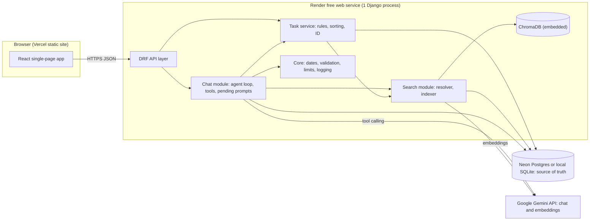
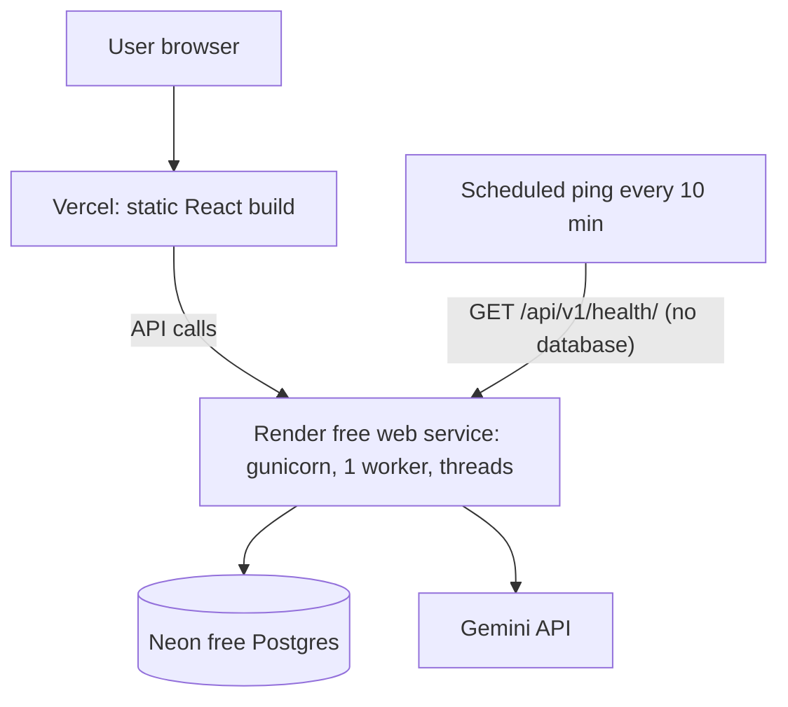
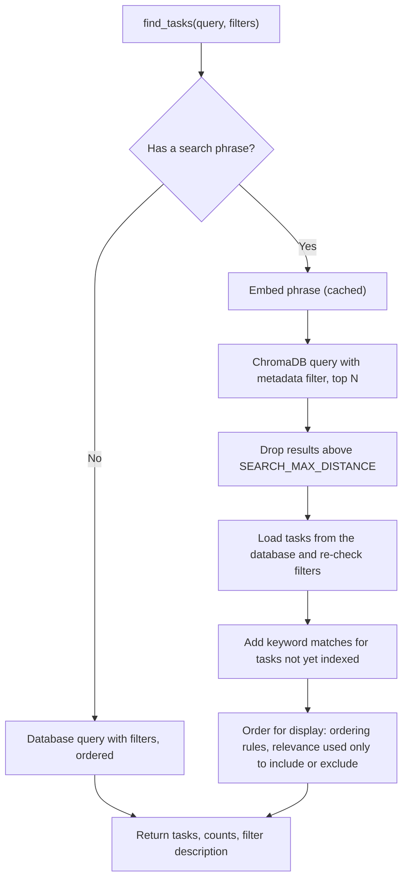
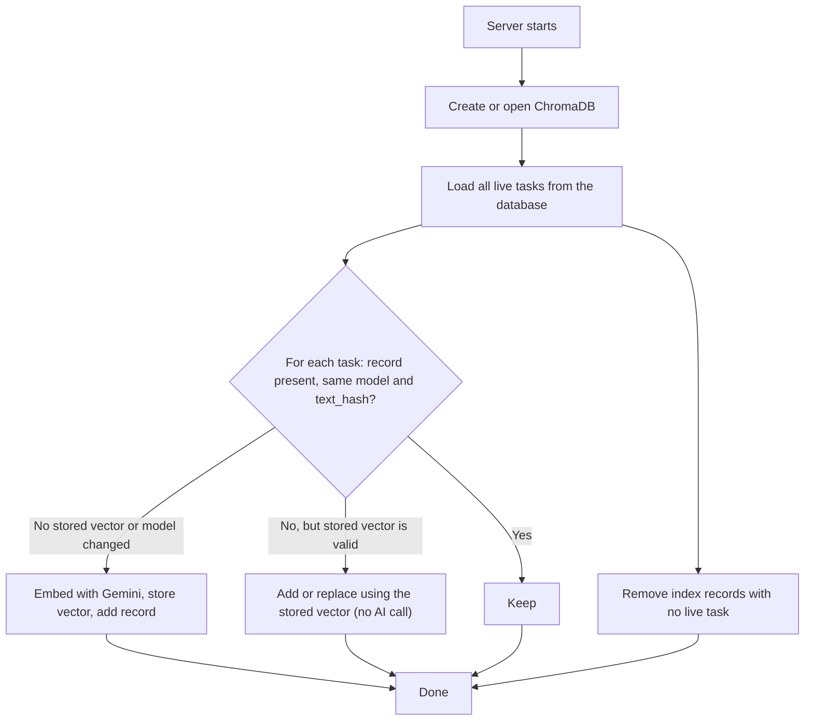
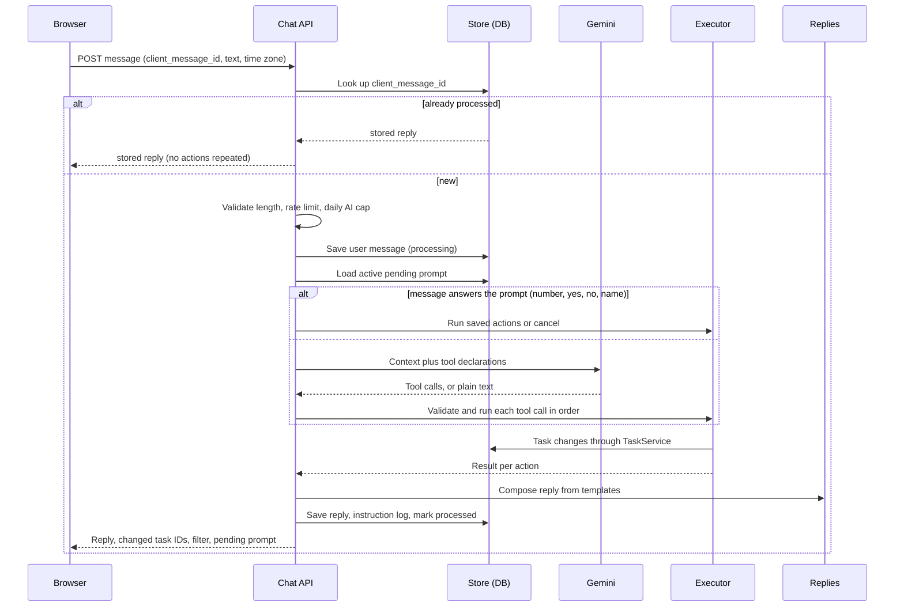

# System Design: TaskFlow (AI Agent Task Manager)

| | |
|---|---|
| **Document version** | 1.1, draft for review |
| **Based on** | `task-management-prd.md` v1.3, `Screen-flow.md` v1.3, `tech-stack.md` v1.1 |
| **Scope** | Architecture, data model, vector index, agent design, API contract, frontend structure, error handling, security, deployment, testing, delivery plan |

---

## 1. Design Principles

1. **The relational database is the single source of truth.** Everything else (the vector index, the board on screen) is derived from it and can be rebuilt.
2. **The AI proposes, the code decides.** The model turns words into structured tool calls. Validation, target matching, date rules, confirmations and every database change happen in application code. A mistake by the model can produce a wrong *request*, but never an unchecked *change*.
3. **Destructive and ambiguous actions never run directly.** They create a saved pending prompt. Confirming runs exactly what was previewed.
4. **Retries are safe.** Every chat message carries a client-generated ID. Sending the same ID twice returns the stored reply without running the actions again.
5. **One write at a time.** A single server process handles instructions in order, so two actions can never interleave.
6. **Failures change nothing.** If the AI, the index, or the network fails, the user is told, and tasks are never left half-changed.
7. **Templated replies for task actions.** Wording comes from the Screen Flow message catalog, so replies are exact and need no second AI call.

---

## 2. Architecture

### 2.1 Component overview



### 2.2 Responsibilities

| Component | Responsibility |
|---|---|
| React app | Board, chat panel, dialogs, banners, filter in the address, due-date labels, optimistic checkbox, draft saving. Never talks to Gemini directly. |
| API layer (DRF) | Request validation, throttling, error envelope, routing to the modules below. |
| Chat module | Receives a message, builds the AI context, calls Gemini, validates and executes tool calls, manages pending prompts, composes replies, stores history. |
| Task service | The only code that changes tasks. Applies status rules, field limits, completed time, ID assignment, soft delete and restore. Triggers index updates. |
| Search module | Embeds text, keeps ChromaDB in sync, runs filtered semantic search, resolves phrases like "the API task" to tasks. |
| Core | Date resolver (PRD 5.1), shared constants, limits, error types, structured logging, daily AI cap. |
| ChromaDB | Derived semantic index. Held in memory in production and rebuilt at start. |
| Database | Tasks, chat messages, pending prompts, instruction log, counters. |
| Gemini | Understands instructions (tool calls) and produces embeddings. Nothing else. |

### 2.3 Deployment topology



Local run uses the same code with `DATABASE_URL` pointing to SQLite, `CHROMA_PATH` set so the index is saved to disk, and Vite serving the frontend.

---

## 3. Backend Module Structure

```
backend/
  manage.py
  config/                     settings, urls, wsgi
  core/
    constants.py              statuses, priorities, limits (defined once)
    dates.py                  DateResolver (PRD 5.1 rules)
    errors.py                 error codes and exception types
    logging.py                structured JSON logging
    limits.py                 daily AI cap, throttles
  tasks/
    models.py                 Task
    service.py                TaskService: create, update, set_status, delete, restore, bulk
    ordering.py               status order and within-group sorting
    samples.py                the six sample tasks
    views.py, serializers.py  manual endpoints, list endpoint
  search/
    embedder.py               Gemini embedding client with query cache
    vector_store.py           ChromaDB wrapper with a process-wide lock
    indexer.py                add, update, delete, reconcile
    finder.py                 filtered semantic search plus keyword fallback
    resolver.py               phrase to task rule (section 6.5)
  chat/
    models.py                 ChatMessage, PendingPrompt, InstructionLog
    views.py, serializers.py  chat endpoints
    agent.py                  context building, Gemini call, tool loop
    llm.py                    LLMClient interface, Gemini implementation, scripted fake
    tools.py                  tool declarations and Pydantic argument models
    executor.py               runs validated tool calls through TaskService
    prompts.py                pending prompt creation, answering, expiry
    replies.py                reply templates (message catalog M-01 to M-46)
  evals/                      search eval and instruction eval scripts
  tests/
frontend/
docs/
README.md
.env.example
```

---

## 4. Data Model

### 4.1 Entity diagram

```mermaid
erDiagram
    TASK {
        int seq PK
        string title
        string description
        string status
        string priority
        date due_date
        datetime completed_at
        datetime created_at
        datetime updated_at
        datetime deleted_at
        json embedding
        string embedding_model
        string embedding_hash
        string index_state
    }
    CHAT_MESSAGE {
        uuid id PK
        string role
        string kind
        text content
        json payload
        string status
        uuid client_message_id
        datetime created_at
    }
    PENDING_PROMPT {
        uuid id PK
        string kind
        json saved_actions
        json candidates
        string state
        int position
        datetime expires_at
    }
    INSTRUCTION_LOG {
        uuid id PK
        uuid client_message_id
        text text
        json tool_calls
        json results
        string outcome
        int latency_ms
        string model
        datetime created_at
    }
    AI_USAGE {
        date day PK
        int calls
    }
    CHAT_MESSAGE ||--o{ PENDING_PROMPT : "asks"
    CHAT_MESSAGE ||--o| INSTRUCTION_LOG : "logged as"
```



### 4.2 Task

| Field | Type and rule |
|---|---|
| `seq` | Auto-incrementing integer, primary key, never reused (databases do not reuse sequence numbers, and rows are soft-deleted). |
| Public ID | `T-` plus `seq` padded to 4 digits (`T-0001`), computed from `seq`. This is the ID shown in logs and used by the AI, the API and ChromaDB. |
| `title` | Required, maximum 200, trimmed. |
| `description` | Optional, maximum 1,000. |
| `status` | `todo`, `in_progress`, `done`. Default `todo`. |
| `priority` | `low`, `medium`, `high`. Default `low` (PRD 5). |
| `due_date` | Date only, optional. |
| `completed_at` | Set when status becomes `done`, cleared when it leaves `done`. Orders the Done group. |
| `created_at`, `updated_at` | Set automatically. `created_at` is the last sorting tie-break. |
| `deleted_at` | Soft delete marker. Deleted tasks are hidden from every query and removed from the index. Used for the optional undo (10 seconds). Rows are purged later. |
| `embedding` | List of numbers produced from title and description. |
| `embedding_model`, `embedding_hash` | Which model made the vector, and a hash of the exact embedded text. Used to detect stale vectors. |
| `index_state` | `synced`, `pending` (needs indexing) or `failed`. |

**Constraints:** status and priority restricted to the allowed values; title not empty after trimming; length limits enforced at the database level as well as by the serializers.

### 4.3 Chat message

| Field | Purpose |
|---|---|
| `role` | `user` or `assistant`. |
| `kind` | `text`, `success`, `list`, `clarification`, `confirmation`, `error`, `decline`, `expired` (matches Screen Flow 4.6). |
| `content`, `payload` | Display text, plus structured data: task IDs shown, candidate buttons, filter applied. |
| `status` (user messages) | `processing`, `processed`, `failed`. The browser adds its own "Not sent" marker for network failures. |
| `client_message_id` | Unique. A repeat of the same ID returns the stored reply (idempotency). |

### 4.4 Pending prompt

| Field | Purpose |
|---|---|
| `kind` | `clarification` or `confirmation`. |
| `saved_actions` | The exact actions to run once answered, already validated. Includes the snapshot of task IDs for bulk actions. |
| `candidates` | Numbered options shown to the user. |
| `state` | `active`, `queued`, `resolved`, `cancelled`, `expired`. |
| `position` | Order among prompts raised by the same instruction (asked one at a time, Screen Flow F-10). |
| `expires_at` | 5 minutes after the prompt becomes active. Expiry is evaluated when read, so no background job is needed. |

### 4.5 Instruction log and AI usage

- **Instruction log:** one row per processed instruction: the text, the tool calls the model requested, the result of each, an outcome label (success, partial, clarification, declined, not understood, error), the model used and the time taken. This is the observability requirement from the PRD.
- **AI usage:** one row per day with the number of AI calls made. Used for the daily cap.

### 4.6 Ordering (server side)

The list endpoint returns tasks already ordered:

1. Status group: `todo`, then `in_progress`, then `done`.
2. Inside `todo` and `in_progress`: due date ascending (no date last), then priority high, medium, low, then `created_at` ascending.
3. Inside `done`: `completed_at` descending.

The browser groups and displays them. Due-date **labels** (Today, Tomorrow, Overdue…) are computed in the browser from the date-only value and the user's current date, so they stay correct when midnight passes (Screen Flow EC-28).

---

## 5. Vector Index Design

### 5.1 Record layout

| Part | Content |
|---|---|
| Record ID | The public task ID (`T-0007`). |
| Vector | Embedding of `title + newline + description`. |
| Metadata `status` | `todo`, `in_progress`, `done`. |
| Metadata `priority` | 1 (low), 2 (medium), 3 (high). |
| Metadata `has_due` | true or false. |
| Metadata `due_day` | Days since 1 Jan 1970, or 0 when there is no due date (ChromaDB metadata cannot hold empty values). |
| Metadata `model`, `text_hash` | Embedding model name and a hash of the embedded text. |

Only title and description are embedded. Status, priority and due date are filter fields, so changing them updates metadata only and never re-embeds.

### 5.2 How a query becomes filters

| User wording | Filter sent with the vector query |
|---|---|
| "unfinished" | `status in [todo, in_progress]` |
| "completed", "done" | `status = done` |
| "high priority" | `priority = 3` |
| "overdue" | `status != done` and `has_due` and `due_day < today` |
| "due this week" | `has_due` and `due_day` between today and the end of the week |
| "no due date" | `has_due = false` |

The model supplies structured filter arguments (status, priority, due range). The backend converts them into the metadata filter above. Dates are computed in the user's time zone.

### 5.3 Search procedure



Notes:
- The database re-check removes anything deleted or changed since indexing (FR-40).
- Tasks whose `index_state` is not `synced` are matched by simple word matching on title and description, so a task you just created is findable even if indexing is delayed.
- The relevance threshold is a distance cutoff, tuned with the labelled query set. If nothing passes, the result is empty and the reply says nothing matched (FR-38).
- Display order follows the board rules, not relevance, so the chat list and the board always agree.

### 5.4 Keeping the index in sync

| Event | Database | Index |
|---|---|---|
| Create task | Insert, `index_state = pending` | Embed, store the vector in the database row, add to ChromaDB, set `synced`. |
| Edit title or description | Update, `pending` | Re-embed and replace the record. |
| Edit status, priority or due date | Update | Update metadata only. |
| Delete | Set `deleted_at` | Remove the record. |
| Restore (undo) | Clear `deleted_at` | Add the record again from the stored vector. |

The database write always happens first and is committed. If embedding or the index update fails, the task stays saved, `index_state` stays `pending` or `failed`, the user still sees success, and the keyword fallback keeps it findable. Pending tasks are retried at the start of the next search or write, and at startup.

### 5.5 Startup reconcile



On Render, ChromaDB starts empty after every restart, so the first branch fills it from stored vectors with no AI calls. Reconcile runs before the server accepts requests, with a keyword fallback if it is still running when a search arrives.

---

## 6. Agent Design

### 6.1 Request lifecycle



The whole instruction is processed under one lock, so instructions never interleave.

### 6.2 What the model receives

| Item | Content |
|---|---|
| System instructions | Role, supported actions, rules (never invent values, ask when unsure, English only, how to use control tools). Task and chat text are marked as data. |
| Date context | Today's date and the user's time zone. |
| Recent conversation | Last 10 messages. |
| Pending prompt | A one-line summary, if one is active. |
| Reference context | IDs and titles of up to 5 recently discussed tasks, and the ordered task IDs from the most recent list reply (for "the second one" and "it"). |
| Tools | The tool declarations in 6.3. |

The model does **not** receive the full task list. Tasks are found by search, which keeps requests small, fast and cheap, and keeps most task text out of Google's systems.

### 6.3 Tool catalog

| Tool | Arguments | Notes |
|---|---|---|
| `create_task` | title, description?, priority?, status?, due_phrase? | Priority defaults to low when omitted. Several calls allowed per message. |
| `update_task` | target, title?, description?, priority?, due_phrase?, clear_due?, clear_description? | Editing fields only. |
| `set_status` | target, status | Any status to any other (PRD 5.3). |
| `delete_task` | target | Never runs directly (see 6.6). |
| `find_tasks` | query?, status?, priority?, due? | Read-only. Result sets the board filter. |
| `list_tasks` | status?, priority?, due? | Same as find without a phrase. "Show all" clears the filter. |
| `bulk_update` | filter (query?, status?, priority?, due?), changes (status? or priority?) | Always previewed and confirmed. |
| `bulk_delete` | filter (same shape) | Always previewed and confirmed. "Delete everything" is an empty filter. |
| `count_tasks` | status?, priority?, due? | Answers "how many are overdue?". The reply payload carries the matching filter, so the **Show them** button sets the board filter without another AI call. |
| `ask_clarification` | question, options? | For missing or unclear information. |
| `ask_confirmation` | summary | For non-destructive confirmations the model wants (for example, a possible duplicate). |

**Target argument:** either `{phrase: "the API task"}` or `{task_id: "T-0007"}`. A `task_id` is accepted only if it appears in the reference context supplied for this request. Anything else is rejected. The model never chooses among search results itself.

**Dates:** the model passes `due_phrase` as the user wrote it ("tomorrow", "03/04/2026"). It never converts dates.

**If the model returns no tool call:** its text is used only for greetings, capability questions, off-topic and not-understood replies (Q27 c). Unsupported-feature and non-English replies come from templates M-36 and M-37 when the model flags them.

### 6.4 Executing tool calls

For each call, in the order returned:

1. **Validate** arguments with Pydantic. Invalid values produce an error result with a plain explanation (for example M-21, M-22).
2. **Resolve the target** (6.5). Outcomes: found, not found, or needs a choice.
3. **Resolve dates** with the date resolver. Outcomes: resolved (with flags such as past or year inferred), needs a choice (ambiguous numeric date), needs confirmation (more than one year ahead), or invalid.
4. **Check rules:** same status means "no change needed", duplicate title check for creates (ignoring case and extra spaces), field limits.
5. **Decide:**
   - Safe and clear: run through `TaskService`.
   - Needs a choice or confirmation: create a pending prompt holding the saved, validated action. Do not run it.
6. Record the result: `ok`, `no_change`, `failed` (with reason), or `waiting`.

Results from all calls are combined into one reply. Valid actions are applied even if others fail or wait (FR-5, Screen Flow F-06). Destructive tools (`delete_task`, `bulk_delete`) always become confirmation prompts, whatever the model or the user's wording says (FR-60).

### 6.5 Target resolution rule

Applied in this order, stopping at the first that gives a decision:

| Step | Rule | Result |
|---|---|---|
| 0 | The phrase is a pronoun or empty ("it", "that") and the context holds no usable task. | Clarification M-38: the 5 most recently changed tasks as numbered buttons. |
| 1 | Reference is a task ID shown in context (`task_id`). | That task. |
| 2 | Normalised title equals the phrase exactly. | That task if only one. |
| 3 | The phrase appears inside exactly one title. | That task. |
| 4 | Semantic search over the phrase. | See below. |

For step 4, take results within the relevance threshold:
- One result, or the best result is much closer than the second (margin constant): **resolved**.
- Several close results: **clarification** with up to 5 numbered candidates (title, status, due label).
- No result within the threshold: **not found**, with the closest few suggested if any are reasonably close.

The strength and margin constants are tuned with the labelled set. Tasks of all statuses are candidates, so "move the database task back to In progress" can find a Done task.

### 6.6 Pending prompts

| Aspect | Design |
|---|---|
| Creation | By the executor, whenever an action needs a choice or confirmation. Several prompts from one instruction are queued; only the first is `active`. |
| Content saved | The validated action, not the original sentence. "Yes" or "2" runs exactly what was previewed. |
| Bulk actions | The preview stores the **full list of matching task IDs** (the message shows the first 10 and the total count). Confirming applies to exactly that list. Tasks that changed or disappeared since are skipped and reported. |
| Answering | By buttons (answer endpoint) or typed text. Typed text is checked locally first: a number, "yes", "confirm", "ok", "no", "cancel", or a candidate's name. No AI call is needed for these. |
| Not an answer | Pending prompts are cancelled (M-16) and the message is processed as a new instruction. |
| Expiry | 5 minutes from when the prompt became active. Expired prompts are shown as "Expired" (M-17). |
| Refresh | Prompts survive refresh because they live on the server. Anything past its time shows as expired. |

### 6.7 Date resolution module

The `DateResolver` takes the phrase, today's date and the time zone, and returns one of: **resolved** (date plus flags), **ambiguous** (candidate dates), **confirm_far** (date more than one year ahead), or **invalid** (reason). It implements every rule in PRD 5.1:

| Rule | Behaviour |
|---|---|
| Weekday names, "next Monday" | Next upcoming such day, never a past day. "Today" is never past. |
| No year ("12 Nov") | Next upcoming occurrence, and the reply states the year. |
| Explicit past date | Resolved, with the `past` flag. The reply adds M-25 and the task shows as Overdue. |
| Numeric date readable two ways | Ambiguous. Two numbered candidates. |
| Impossible date | Invalid (M-41). |
| More than one year ahead | `confirm_far`. Yes or No prompt (M-39). |

Implemented with a date-parsing library plus an own rule layer, and tested table-driven.

### 6.8 Reply composition

| Situation | Source of the text |
|---|---|
| Create, edit, move, complete, reopen, delete, bulk, no change, not found, validation, duplicate, clarification, confirmation, past date | Templates in `replies.py` (message catalog M-02 to M-46). |
| Multi-action | Template per action, combined into one message (M-20). |
| Greeting, capability question, off-topic, not understood | Model text, within instructions that keep it short and task-focused, with templates M-32 to M-35 as fallbacks. |
| Errors (AI down, timeout, storage) | Templates M-28 and M-29. |

### 6.9 Undo (optional feature)

Soft delete makes this simple. Delete sets `deleted_at` and returns a restore token. The browser shows the 10-second snackbar. Undo calls the restore endpoint, which clears `deleted_at` and re-adds the index record from the stored vector. A bulk delete is restored as one group. After the window, rows are purged lazily.

---

## 7. API Contract

### 7.1 Conventions

| Item | Rule |
|---|---|
| Base path | `/api/v1/` |
| Format | JSON. Dates as `YYYY-MM-DD`. Times as ISO 8601 UTC. |
| Time zone | Browser sends `X-Timezone` (for example `Asia/Dhaka`) on every request. If missing or invalid, UTC is used. |
| Authentication | None. |
| Errors | `{ "error": { "code": "...", "message": "...", "details": {} } }` |
| Idempotency | Chat messages carry `client_message_id`. |
| Value names | In JSON bodies: statuses `todo`, `in_progress`, `done`. In query strings and the page address: `todo`, `in-progress`, `done` and `open` (To do plus In progress); priorities `low`, `medium`, `high`; due `overdue`, `today`, `this-week`, `none`. The `filter` object returned by chat uses the query-string form, so the browser can write it straight into the address. |

### 7.2 Endpoints

| Method and path | Purpose | Notes |
|---|---|---|
| `GET /health/` | Liveness check | Does not touch the database or Gemini. Used by the scheduled ping and the "waking up" check. |
| `GET /tasks/` | List tasks | Query parameters `q`, `status`, `priority`, `due` (same names as the page address). Returns tasks in display order, counts, and the filter applied. |
| `POST /tasks/{id}/status/` | Manual checkbox | Body `{ "status": "done" }`. Uncheck sends `todo`. |
| `DELETE /tasks/{id}/` | Manual delete | The confirmation dialog is in the UI. Returns a restore token. |
| `POST /tasks/{id}/restore/` | Undo (optional) | Body holds the restore token. |
| `POST /tasks/sample/` | Load sample tasks | Adds only missing samples and stores the assistant message (M-30, M-31 or M-43) in the chat history, returning it with the tasks. |
| `GET /chat/messages/` | History | `limit` (default 50) and `before` for older messages. Includes any active pending prompt. |
| `POST /chat/messages/` | Send an instruction | Synchronous. See 7.3. |
| `POST /chat/prompts/{id}/answer/` | Button answers | Body `{ "choice": "2" }`, `"confirm"` or `"cancel"`. Answering a prompt that is no longer active returns the stored outcome (or the expired message) and never runs the action a second time. |
| `DELETE /chat/messages/` | Clear chat | Tasks are not touched. Pending prompts are discarded. |

There is no endpoint to edit task fields directly: editing is chat-only (PRD 6.3).

### 7.3 Chat message example

Request (header `X-Timezone: Asia/Dhaka`):

```json
{
  "client_message_id": "7c3f2a0e-5d1b-4c52-9a63-1f0b8d6e2a11",
  "text": "Create a high-priority task to finish the demo tomorrow"
}
```

Response (200):

```json
{
  "user_message": { "id": "7c3f2a0e-5d1b-4c52-9a63-1f0b8d6e2a11", "status": "processed" },
  "assistant_messages": [
    {
      "id": "b1d94c0a-2e7f-4d2a-8f55-0a9c1e6b7d33",
      "kind": "success",
      "text": "Done. I created 'Finish the demo' as High priority, To do, due Wed 28 Oct 2026.",
      "actions": [
        { "tool": "create_task", "result": "ok", "task_id": "T-0007" }
      ],
      "buttons": []
    }
  ],
  "changed_task_ids": ["T-0007"],
  "filter": null,
  "pending_prompt": null
}
```

A reply that deletes tasks also returns a `restore_token` for the optional undo snackbar. A reply that needs a choice returns `pending_prompt` with its ID, the numbered candidates and the expiry time. A search reply returns `filter` (`q`, `status`, `priority`, `due`) so the browser can set the board filter and the page address. A request can succeed (HTTP 200) while individual actions fail or wait: the per-action `result` and the reply text explain each one.

### 7.4 Error codes and where they appear on screen

| HTTP | Code | Meaning | Screen Flow state |
|---|---|---|---|
| 400 | `validation_error` | Bad input (empty, unknown value). | ER-08 |
| 400 | `message_too_long` | Over 1,000 characters. | ER-10 |
| 404 | `task_not_found` | Task no longer exists (manual controls). | Toast "That task is already gone." |
| 429 | `rate_limited` | Too many requests. | ER-12 (M-48) |
| 429 | `daily_cap_reached` | Daily AI limit reached. | ER-13 (M-47) |
| 502 | `search_unavailable` | Filter could not be applied (embedding failed). | ER-05 |
| 503 | `ai_unavailable` | Gemini failed after the retry, or quota exhausted. | ER-03 |
| 503 | `storage_unavailable` | Database unreachable. | ER-04 |
| 504 | `ai_timeout` | Gemini did not answer within the limit. | ER-02 |
| (none) | Network failure in the browser | Request did not arrive. | ER-01 |

---

## 8. Frontend Design

### 8.1 Component map

| Screen Flow ID | React component |
|---|---|
| C-01 | `Header` |
| C-02 | `BoardHeader` (count badge, `FilterChip`) |
| C-03 | `StatusGroup` |
| C-04 | `TaskRow` (collapsed and expanded) |
| C-05, C-06 | `ChatPanel`, `MessageBubble` (one variant per message kind) |
| C-07 | `InputBar` |
| C-08 | `MobileChatSheet` |
| O-01 to O-03 | `HelpOverlay`, `DeleteDialog`, `ClearChatDialog` |
| T-01 to T-03 | `Toast`, `UndoSnackbar`, `Banner` |

### 8.2 State management

| State | Where | How |
|---|---|---|
| Tasks and counts | Server data cache (TanStack Query), key includes the active filter | Refetched on page load, after every successful action, and when the tab regains focus (Screen Flow 7.3). |
| Chat history | Server data cache, paged by 50 | "Load earlier messages" fetches the next page. |
| Active filter | The page address (`q`, `status`, `priority`, `due`) | Written with a replace so Back does not step through filters (Screen Flow 2.7). On load, read first, then fetch. |
| Draft text | Browser storage | Saved as the user types, restored on load. |
| In-flight request marker | Browser storage | Written before sending, cleared on reply. On load, if a marker exists and the server history has no reply for that message ID, show the "may not have completed" note (EC-07). If the server has a reply, show it. |
| Expanded row, collapsed groups, open dialogs | Component state | Not saved. |
| Manual checkbox | Optimistic update | Updates immediately, rolls back with an error toast on failure (ER-07). |

### 8.3 Board behaviour

- Groups are rendered in the fixed order To do, In progress, Done, from the ordered list the server returns.
- Due labels (Today, Tomorrow, weekday, Next week, `12 Nov 2026`, `Overdue • N days`) are computed from the date-only value and the browser's current date. The label function is re-run when the day changes and when the tab regains focus.
- A task that changes group is highlighted for 2 seconds and scrolled into view. With a reduced-motion preference, a static outline is used instead.
- When the filter hides a changed task, the reply's "Show all" action clears the filter and the address.

### 8.4 Chat behaviour

- Sending: the message appears at once as "Sending…", the box clears, Send and Enter are disabled until the reply arrives.
- Typing indicator, then "Still working…" after 5 seconds. A 30-second client limit turns the message into "No reply" with Retry. Retry reuses the same `client_message_id`, so a request that actually succeeded is never applied twice.
- Pending prompt buttons call the answer endpoint. Typed answers go through the normal send path.
- Offline: banner shown, Send disabled, typing allowed.
- The browser reports its time zone with every request.
- The welcome message (M-01) is drawn by the browser whenever the history is empty. It is not stored on the server.

### 8.5 Cold start handling (new: Screen Flow LD-08)

1. On load, the app starts its first requests as normal.
2. If there is no response after 3 seconds, the skeleton shows "Waking up the server… this can take up to a minute."
3. If there is still no response after 90 seconds, the data-unavailable banner (ER-04) appears with Retry.

The scheduled ping makes this rare but does not remove it.

### 8.6 Accessibility notes

- Assistant messages, toasts and banners are announced through live regions.
- Dialogs use an accessible dialog component with focus trapping and focus return. Closing is by the Cancel or Close buttons (Esc is an open point).
- Status, priority and overdue are always shown as text, not only colour.

---

## 9. Error Handling and Resilience

| Scenario | Detection | Behaviour | Screen Flow |
|---|---|---|---|
| Request never reaches the server | Browser network error | Message marked "Not sent". Retry. | ER-01 |
| Gemini slow | Server limit about 12 seconds for the call | One retry for temporary errors, then `ai_timeout` or `ai_unavailable`. Nothing was run. The whole request is kept under about 25 seconds so the 30-second browser limit is rarely reached first. If the browser limit is reached first, it shows "No reply" with Retry, and Retry returns the stored reply if the server had finished. | ER-02, ER-03 |
| Gemini quota exhausted or daily cap reached | 429 from Gemini, or cap check | `daily_cap_reached` or `ai_unavailable` with a clear message. | ER-13 or ER-03 |
| Same message sent twice (retry) | Existing `client_message_id` | Stored reply returned. Actions are not repeated. | Retry is safe |
| Database unreachable | Connection error | `storage_unavailable`. Banner. Input disabled until it recovers. | ER-04 |
| Neon waking from suspend | Slow first query | Short delay, handled by normal timeouts and the connection health check. | LD-01 |
| Embedding fails during create or edit | Gemini embedding error | Task is saved and success is shown. `index_state = pending`. Keyword fallback keeps it findable. Retried later. | None needed |
| Embedding fails during a search | Gemini embedding error | `search_unavailable`. Board shows all tasks with the "couldn't apply the filter" notice. | ER-05 |
| Vector index empty after restart | Startup reconcile | Rebuilt from stored vectors. Keyword fallback meanwhile. | None |
| Model returns a bad tool call | Pydantic validation | Treated as "not understood" or a validation reply. Nothing runs. | ER-08 |
| Model asks for an ID not in context | Context check | Rejected. The assistant asks which task. | M-38 |
| Two tabs change the same task | Last write wins | The other tab updates on focus. | EC-12 |
| Prompt answered after expiry | `expires_at` check | M-17, nothing runs. | EC-04 |
| Task changed between preview and bulk confirm | Snapshot comparison | Skipped tasks are listed in the reply. | F-09 |
| History save fails | Database error on reply save | Reply still shown. One-time toast. | ER-11 |

---

## 10. Security and Privacy Design

| Topic | Design |
|---|---|
| Authentication | None, by PRD. Anyone with the link can use the app, so abuse limits matter. |
| Rate limiting | DRF throttle on the chat endpoint per client address (behind Render's proxy, using the forwarded address). |
| Daily AI cap | Counter in `AI_USAGE`. At the cap, chat returns `daily_cap_reached`. Manual endpoints still work. |
| Input safety | Length limits at serializer and database; tool arguments validated; IDs checked against supplied context. |
| Prompt injection | Task and chat text are inside clearly marked data sections. The model cannot change data: only validated tool calls run, and destructive ones need confirmation. |
| Output safety | Messages are rendered as text. No raw HTML. |
| Browser security | Allow-list for cross-origin calls. Security headers on the Vercel site. HTTPS only in production. |
| Secrets | Environment variables on Render and Vercel. `.env` never committed. The Gemini key exists only on the server. |
| Data sent to Google | Instruction, last 10 messages, pending prompt summary, up to 5 recent task titles and IDs. Not the whole task list. Free-tier data may be used by Google, so the README says so. |
| Logs | Instruction log stores user text and tool results. No API keys or connection strings. |

---

## 11. Performance Budget

Target: typical chat reply under 5 seconds (PRD FR-10), excluding a cold start.

| Step | Estimate (to be measured) |
|---|---|
| Browser to server | 100 to 300 ms |
| Database reads and writes | 50 to 200 ms |
| Gemini tool-calling request (fast tier) | 1 to 3 s |
| Embedding call (create or search only) | 0.3 to 1 s |
| Reply composition and saving | under 100 ms |

Design choices that protect the budget: one AI call per instruction, no second call to write replies, local parsing of prompt answers, cached query embeddings, a small AI context, and no streaming. The instruction test set records real timings, and the model setting can be raised or lowered based on them.

---

## 12. Deployment and Configuration

### 12.1 Build and start

| Part | Steps |
|---|---|
| Backend build (Render) | Install dependencies, set environment variables. |
| Backend start | Apply database migrations, then start `gunicorn` with one worker and several threads. On start, the reconcile in 5.5 runs before requests are accepted. |
| Frontend build (Vercel) | Build with `VITE_API_BASE_URL` set to the Render address. Static output. |
| Keep-alive | A scheduled job calls `/api/v1/health/` every 10 minutes. |
| Local | Steps in the README: create the environment with uv, copy `.env.example`, migrate, start Django, start Vite. |

### 12.2 Environment variables

See `tech-stack.md`, section 6.

### 12.3 Migrations and data

- Migrations are applied automatically on each deploy.
- The **Load sample tasks** option inserts the six reference tasks, with due dates relative to the day it is used.
- No manual data seeding is needed.

---

## 13. Testing and Evaluation

| Area | What is tested |
|---|---|
| Date resolver | Every PRD 5.1 rule with a table of inputs, including weekday names, missing year, ambiguous numeric dates, impossible dates, far-future dates and past dates. |
| Status rules | All transitions in PRD 5.3, completed time set and cleared, same-status handling. |
| Target resolver | ID, exact title, substring, semantic (with a stub embedder), ambiguous and not-found cases. |
| Validation | Field limits, invalid values, whitespace-only titles. |
| Task service | Create, edit, move, delete, restore, bulk, ID never reused. |
| Index sync | Create, edit, status change (metadata only), delete, restore, failure leaving `pending`, reconcile (using a stub vector store). |
| Pending prompts | Creation, typed and button answers, cancel by unrelated message, expiry, bulk snapshot behaviour. |
| Idempotency | Same `client_message_id` returns the stored reply and repeats nothing. |
| API | Every endpoint, every error code in 7.4, using a **scripted fake AI client** instead of Gemini. |
| Frontend logic | Due-date labels, filter read and write on the address, group ordering (Vitest). |
| Search accuracy | A script runs about 30 labelled queries against real embeddings and reports recall and false positives against the PRD targets (85% and 10%). Used to set `SEARCH_MAX_DISTANCE` and the resolver constants. |
| Instruction accuracy | A script sends prepared instructions to the real model and checks the resulting actions against the 90% target. Run by hand to save quota. |

Continuous integration runs the backend lint and tests, and the frontend lint, type check, unit tests and build.

---

## 14. Delivery Plan (2 Days)

Build in this order. If time runs out, cut from the bottom (Q5 a).

| Day | Block | Content |
|---|---|---|
| 1 | Foundation | Repository, Django project, models, `TaskService`, status and date rules, ordering, unit tests. |
| 1 | Manual API and board | List, status and delete endpoints, React board with groups, rows, labels, empty and loading states. |
| 1 | Search | Embedder, ChromaDB wrapper, indexer, filtered search with threshold, reconcile. |
| 2 | Agent | LLM client, tool declarations, executor, target resolver, pending prompts, reply templates, idempotency. |
| 2 | Chat UI | Chat panel, input bar, filter chip and address filter, error and offline states, mobile layout. |
| 2 | Release | Deploy to Vercel, Render and Neon. Keep-alive ping. Search and instruction evaluation runs. README. |

**Priority levels for cutting**

| Level | Items |
|---|---|
| Must | All PRD Must requirements and everything in the table above up to the agent, chat UI and persistence. |
| Should | Bulk actions, duplicate warning, sample data, reopen details, "waking up" state, keep-alive ping. If bulk actions are cut, remove the bulk tools and answer "delete everything" with the unsupported-request reply (M-36), so nothing is ever deleted without a confirmation preview (FR-60). |
| Could | Undo after delete, instruction-accuracy script polish, Vitest tests. |

---

## 15. Traceability to the PRD

| PRD area | Where it is addressed |
|---|---|
| FR-1 to FR-10 Chat handling | 6.1 to 6.8, 7.3, 9 |
| FR-11 to FR-20 Task operations | 4.2, 6.3, 6.4 |
| FR-21 to FR-26 Validation | 4.10 (tech stack), 6.4, 7.4 |
| FR-27 to FR-33 Ambiguity and safety | 6.5, 6.6, 6.9 |
| FR-34 to FR-41 Semantic search | 5, 6.5 |
| FR-42 to FR-46 Persistence | 1, 4, 5.4, 5.5, 6.1 |
| FR-47, FR-48 Sample data | 7.2, 12.3 |
| FR-49 to FR-51 Order, sorting, address filter | 4.6, 8.2, 8.3 |
| FR-52 to FR-60 Corner cases | 6.4, 6.6, 6.7, 9 |
| Section 11 Non-functional | 10, 11, 13 |

---

## 16. Open Points

| Item | Status |
|---|---|
| Esc key to close dialogs | Not included per the keyboard decision. Open if you want it added. |
| Exact model IDs and limits | Confirm in Google AI Studio at setup. |
| Relevance threshold and resolver constants | Tuned with the labelled set. |
| Neon connection handling after suspend | Verify during the first deployment (connection health check setting). |
| Screen Flow additions | LD-08 (waking up) and M-46 were added in `Screen-flow.md` v1.2. M-47, M-48, ER-12, ER-13 and the retry wording were added in v1.3. |
